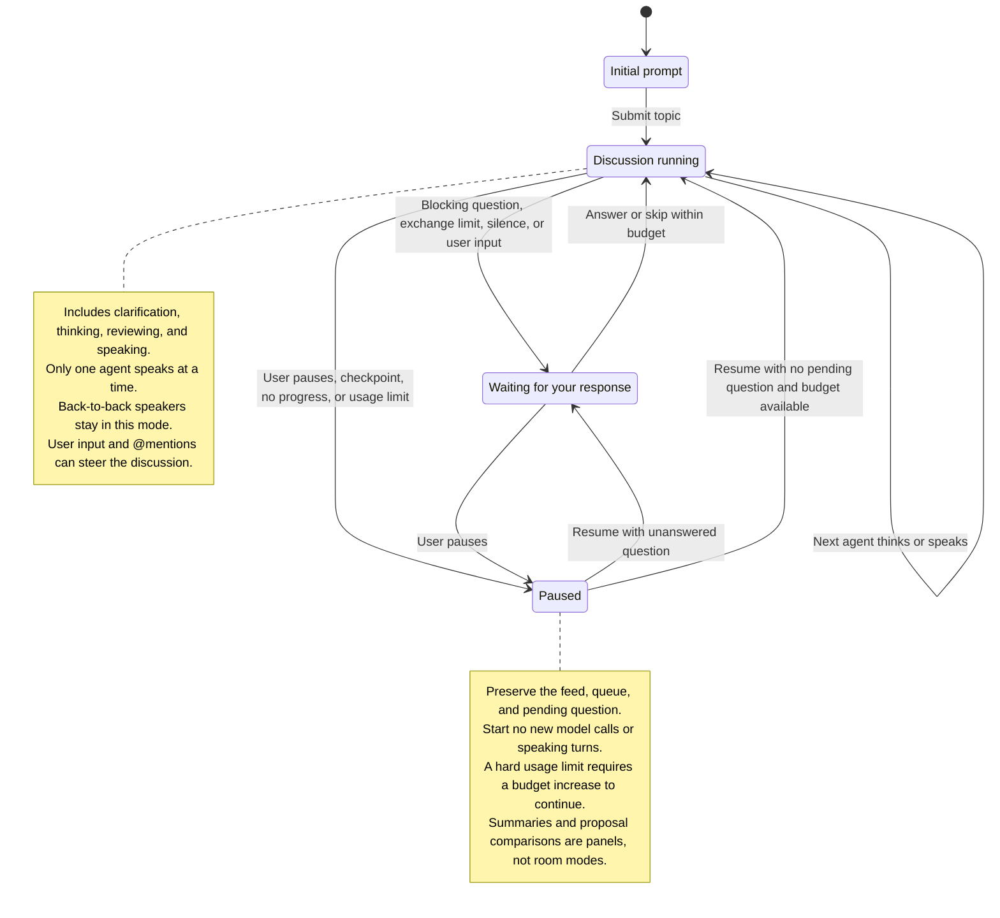
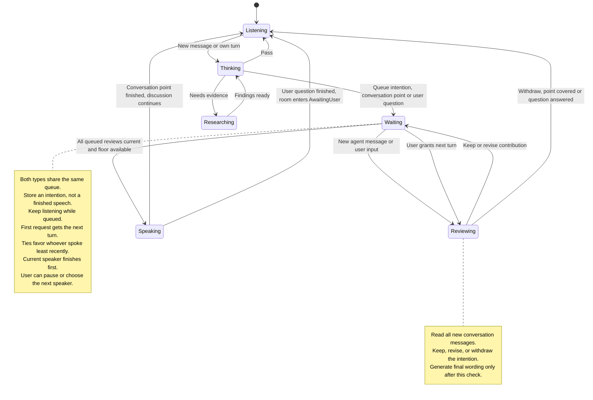
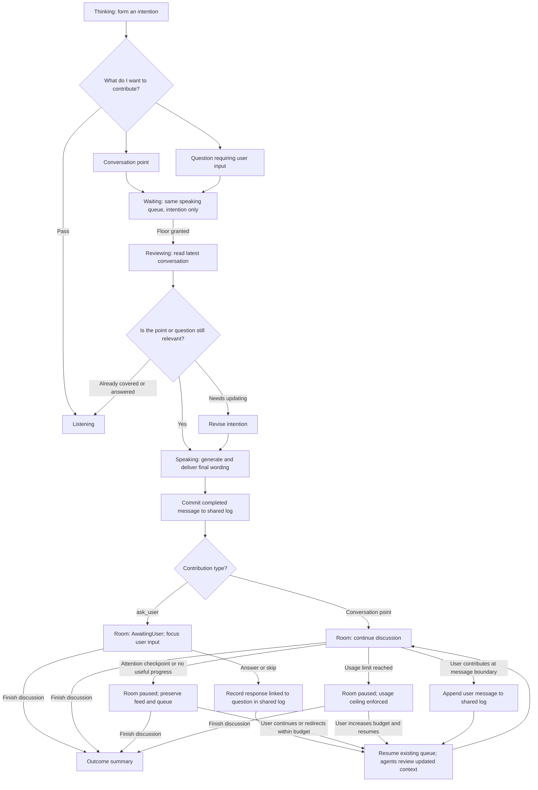

# The Idiots architecture

The room has one mode at a time. Each of the four agents has its own activity state. The local app coordinates both; switching speakers does not change the room mode.

## Implemented exchange scheduling

Both Ink and plain transcript clients use the same local orchestrator. A user submission starts concurrent drafts, with at most one active contribution per character. One character speaks at a time. A hidden `SPEAK TO <name>` header (or a direct address in the text) requests a follow-up; the addressed character takes priority over unrelated queued drafts. After every completed agent message (including thinking announcements), all queued contributions review new context concurrently. KEEP retains a contribution, REVISE updates it in place, and WITHDRAW removes it from the visible queue. The next speaking turn waits until every queued contribution is current. Late drafts review what they missed when ready; unfinished drafts do not block the queue. Reviews share the hard call budget and retain one active model call per agent. Prompts and transcripts identify Ruby (Red), Lemon (Yellow), Jade (Green), and Bleu (Blue), and each character knows the team roster. Persisted IDs remain colors for compatibility.

An exchange yields after six public messages, when everyone passes, when the user submits input, or when a blocking question is delivered. Thinking announcements count toward the six messages. Held work resumes on the next submission and is reviewed before speaking. This is a conversational checkpoint, not a proposal-selection gate. All model calls, including reviews and summaries, remain subject to the hard call budget. Between rounds, once the unsummarized messages pass a size threshold, the oldest whole rounds are folded into a rolling summary by one `summary` call, and prompts carry that summary plus the recent messages word for word. The orchestrator's `history: 'full'` option (used only by the evaluation harness) turns folding off so every prompt carries the whole log. Paused and awaiting-user rooms start no new calls or turns.

Playback gates both live streams and held replies. Ink queues user messages and raises a hand on submission. Ctrl+R also reserves the next turn without submitting or clearing the editor; the current displayed message finishes, then the user has the floor. Raising a hand takes precedence over outstanding reviews. Paused input stays queued until resume; Ctrl+R does not resume a paused room. Plain mode retains Enter to raise a hand. The restored question prompts ask for `QUESTION:` when the answer would change the advice and discourage consecutive questions. The engine uses that marker to create a pending question; both clients hide the marker during streaming and when replaying saved messages. The footer identifies who is waiting without repeating the question.

## Inspecting the live room

The current interfaces are defined in [`src/core/types.ts`](../src/core/types.ts)
and implemented by [`Orchestrator`](../src/core/orchestrator.ts).
`orchestrator.agentState('blue')` returns `{ activity }` and throws for an unknown
agent ID. The engine replaces state objects on transitions; read again to observe
the next state. Activities are `listening`, `thinking`, `deliberating`, `waiting`,
`reviewing`, `speaking`, `has-question`, and `passing`.

`orchestrator.snapshot()` returns the whole room, cached until something changes:

| Field                     | Meaning                                                                                     |
| ------------------------- | ------------------------------------------------------------------------------------------- |
| `mode`                    | `initial-prompt`, `running`, `awaiting-user`, or `paused`                                   |
| `agents`                  | Each agent's activity, keyed by color ID                                                    |
| `speaking`                | Optional `{ agent, text }` for the current streamed or held reply                           |
| `queue`                   | Agents with finished drafts, in speaking order                                              |
| `pendingQuestion`         | Optional `{ agent, eventId, question }` waiting for the user                                |
| `lastTurn`                | Optional `{ agent, result }`; result is `spoke`, `asked`, `passed`, `withdrew`, or `failed` |
| `callsUsed`, `callLimit`  | Usage against the hard model-call budget                                                    |
| `notice`                  | Optional status or error text                                                               |
| `mentioned`, `handRaised` | Who was addressed and whether the user requested the floor                                  |
| `temperatures`, `angry`   | Per-agent boldness and the room's comedy mode                                               |

Subscribe to all room changes, including streamed text, with
`orchestrator.subscribe(listener)`. For animation transitions, use
`orchestrator.subscribeAgents((id, state, previous) => { ... })`: it fires only
when an agent's activity changes. Both return an unsubscribe function. For direct
React integration, wrap the methods so they retain their instance context:

```tsx
const room = useSyncExternalStore(
  (listener) => orchestrator.subscribe(listener),
  () => orchestrator.snapshot(),
);
```

The TUI subscribes through its chat controller, which also handles paced playback.
State-driven animation runs locally and needs no model calls.

## Shared conversation log

The append-only [`EventBus`](../src/core/events.ts) is exposed as
`orchestrator.bus`. Agents read this shared history when building model prompts;
listening itself makes no calls. A separate `new EventBus()` starts an independent,
empty log and does not feed the live discussion.

`bus.log` is a `readonly LogEvent[]` in speaking order. Treat it as read-only;
copy it when a fixed snapshot is needed. `bus.subscribe((event) => { ... })`
reports each append and returns an unsubscribe function.
`JSON.stringify(bus.log, null, 2)` exports the messages directly.

| Field     | Message kinds       | Meaning                                                           |
| --------- | ------------------- | ----------------------------------------------------------------- |
| `id`      | Both                | Zero-based position, assigned by EventBus                         |
| `kind`    | Both                | `user-message` or `agent-message`                                 |
| `text`    | Both                | Full committed message; blocking questions use a `QUESTION:` line |
| `agent`   | Agent only          | `red`, `yellow`, `green`, or `blue`                               |
| `replyTo` | User only, optional | Agent-message ID whose question this answers                      |

```json
[
  {
    "id": 0,
    "kind": "user-message",
    "text": "I want to start a coffee subscription."
  },
  {
    "id": 1,
    "kind": "agent-message",
    "agent": "blue",
    "text": "Start with a preorder test.\nQUESTION: What is your monthly budget?"
  },
  {
    "id": 2,
    "kind": "user-message",
    "text": "About $5k a month.",
    "replyTo": 1
  }
]
```

An agent message joins the log only after it finishes speaking. For text still
being delivered, read `snapshot().speaking`; for the question currently awaiting
an answer, read `snapshot().pendingQuestion`. To find historical question markers,
filter agent messages with `findQuestion` from
[`src/agents/prompts.ts`](../src/agents/prompts.ts). The UI hides the marker while
the saved log retains it.

## Earlier design exploration

The diagrams and proposal/brief machinery below record the earlier continuous-room design. They are future exploration where they differ from this bounded group-chat implementation; mandatory brief consensus and autonomous continuation are not prerequisites for chatting.

## Room states



| Room mode | Interface behavior |
| --- | --- |
| Initial prompt | Enter the topic, goals, and known constraints. |
| Discussion running | Show agent activity, the shared brief, and the conversation; accept input, `@mentions`, and pause. |
| Waiting for your response | Highlight the asking agent's question and focus input; offer answer or skip. |
| Paused | Preserve the conversation and allow the user to contribute, steer, inspect, or resume. |

Pausing while a question is pending preserves that question. Resume returns to waiting for the answer unless the user has answered or skipped it while paused. User input alone does not automatically resume a manually paused room. If an answer or skip exhausts the remaining usage allowance, enter Paused instead of starting another call.

In Paused and AwaitingUser, no new model calls or speaking turns start. In-flight work may finish provisionally; it must be reviewed against current context before being used. An explicit interruption may cancel an active contribution.

Finishing a discussion leaves the room paused with an outcome summary available. Starting a new session opens Initial prompt. Connection errors and budget notices appear as banners within the appropriate mode; proposal comparisons and summaries remain optional panels.

## Agent states

The TUI should feel like a live discussion room, with pixel-art characters and animations that communicate their current activity. Red, Blue, Green, and Yellow share the same states; their personality influences when they speak and what they contribute.



## Contribution and question lifecycle

The room has its own state, separate from each agent's activity. **Waiting** above means an agent is queued to speak. **AwaitingUser** below means the room is paused for your answer.



An agent requests input with a structured `ask_user` contribution. It joins the normal speaking queue and reviews the latest conversation before asking, so a question already answered can be withdrawn. The coordinator records the asking agent and question message ID as the single pending question. A normal contribution containing a rhetorical question does not pause the room.

While the room is `AwaitingUser`, the asking agent returns to Listening, no turns are granted, and no new model calls start. In-flight calls may finish, but their results stay provisional. Existing queue positions are preserved. Answering resumes those existing agent states and the queue; skipping leaves the question unresolved. All agents receive the shared-log update before their next contribution.

The flowchart shows the lifecycle of one intention and its effect on the room; the four agents retain their independent activity states. Ordinary user input still takes priority at the next completed-message boundary; an explicit pause or interruption can cancel an active contribution.

- **Listening:** Idle animation, observing the discussion.
- **Thinking:** Considering a response.
- **Waiting:** Hand raised in a visible speaking queue, still listening. An interjection requests the next turn.
- **Reviewing:** Brief thinking pose while checking the latest conversation; revise the contribution or withdraw before speaking.
- **Speaking:** Active character animation and dialogue.
- **Researching:** Looking something up.

Agreement, disagreement, and surprise can be short reactions layered onto these states.

Only one agent speaks at a time. When two agents raise their hands, both enter the queue. The next agent reviews everything said while it waited before taking the floor. User input takes priority: the user can pause the discussion, contribute, or choose who speaks next.

