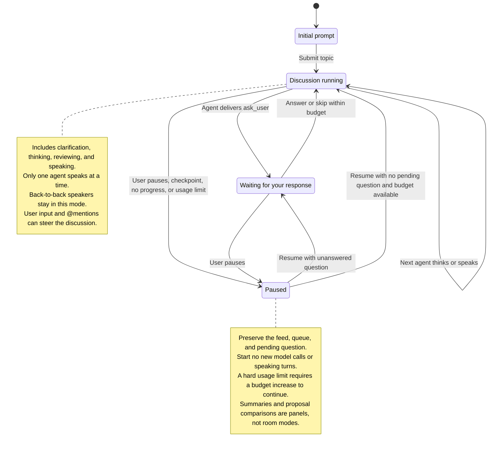
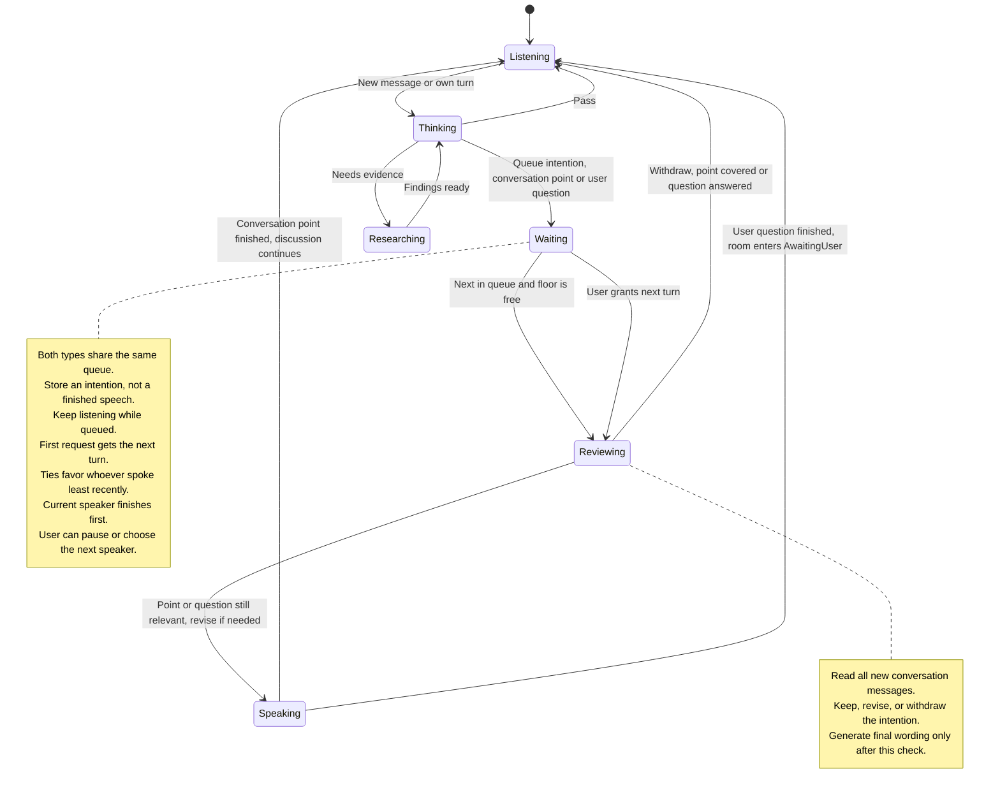
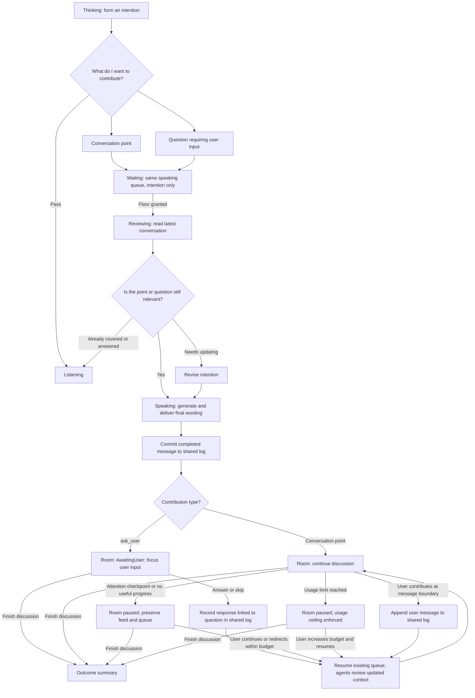

# The Idiots architecture

The room has one mode at a time. Each of the four agents has its own activity state. The local app coordinates both; switching speakers does not change the room mode.

## Room states

| Room mode | Interface behavior |
| --- | --- |
| Initial prompt | Enter the topic, goals, and known constraints. |
| Discussion running | Show agent activity, the shared brief, and the conversation; accept input, `@mentions`, and pause. |
| Waiting for your response | Highlight the asking agent's question and focus input; offer answer or skip. |
| Paused | Preserve the conversation and allow the user to contribute, steer, inspect, or resume. |

Pausing while a question is pending preserves that question. Resume returns to waiting for the answer unless the user has answered or skipped it while paused. User input alone does not automatically resume a manually paused room. If an answer or skip exhausts the remaining usage allowance, enter Paused instead of starting another call.

In Paused and AwaitingUser, no new model calls or speaking turns start. In-flight work may finish provisionally; it must be reviewed against current context before being used. An explicit interruption may cancel an active contribution.

Finishing a discussion leaves the room paused with an outcome summary available. Starting a new session opens Initial prompt. Connection errors and budget notices appear as banners within the appropriate mode; proposal comparisons and summaries remain optional panels.

## Agent states

The TUI should feel like a live discussion room, with pixel-art characters and animations that communicate their current activity. Red, Blue, Green, and Yellow share the same states; their personality influences when they speak and what they contribute.

## Contribution and question lifecycle

The room has its own state, separate from each agent's activity. **Waiting** above means an agent is queued to speak. **AwaitingUser** below means the room is paused for your answer.

An agent requests input with a structured `ask_user` contribution. It joins the normal speaking queue and reviews the latest conversation before asking, so a question already answered can be withdrawn. The coordinator records the asking agent and question message ID as the single pending question. A normal contribution containing a rhetorical question does not pause the room.

While the room is `AwaitingUser`, the asking agent returns to Listening, no turns are granted, and no new model calls start. In-flight calls may finish, but their results stay provisional. Existing queue positions are preserved. Answering resumes those existing agent states and the queue; skipping leaves the question unresolved. All agents receive the shared-log update before their next contribution.

The flowchart shows the lifecycle of one intention and its effect on the room; the four agents retain their independent activity states. Ordinary user input still takes priority at the next completed-message boundary; an explicit pause or interruption can cancel an active contribution.

- **Listening:** Idle animation, observing the discussion.
- **Thinking:** Considering a response.
- **Waiting:** Hand raised in a visible speaking queue, still listening. An interjection requests the next turn.
- **Reviewing:** Brief thinking pose while checking the latest conversation; revise the contribution or withdraw before speaking.
- **Speaking:** Active character animation and dialogue.
- **Researching:** Looking something up.

Agreement, disagreement, and surprise can be short reactions layered onto these states.

Only one agent speaks at a time. When two agents raise their hands, both enter the queue. The next agent reviews everything said while it waited before taking the floor. User input takes priority: the user can pause the discussion, contribute, or choose who speaks next.

