# Final Orchestrator: Conversation Knowledge Graph → Decision & Implementation Graphs

> **Implementation specification for Codex**  
> **Status:** Design baseline / MVP engineering plan  
> **Implementation language:** TypeScript. Schemas below use language-neutral pseudocode; implement them as TypeScript types/interfaces and runtime validators in the existing codebase.  
> **Primary scope:** Step 1 (conversation extraction) and Step 2 (graph construction, linking, reconciliation, validation).  
> **Final product contract:** The user interacts through an existing terminal UI (TUI). The only required user-facing artifact after finalization is a valid, editable `.excalidraw` file. Step 3 (rendering/export) is required for end-to-end completion but its full implementation is intentionally **out of scope of this Step 1–2 specification**.

---

## 0. What we are building

The product starts with a user's idea or goal. Four conversational agents, inspired by the Red / Yellow / Green / Blue perspectives from *Surrounded by Idiots*, independently consider that idea. They may request a turn in a speaking queue, debate proposals, challenge one another, and react to user input. **The user is the final authority over their own choices.**

This README specifies the **final orchestrator** that runs on a completed (or snapshot of an ongoing) multi-agent conversation. Its job is to turn discussion into two useful representations:

1. **Decision Graph** — what choices were considered, which were accepted or deferred, the alternatives, the relevant constraints, the arguments, and each agent's actual expressed opinion.
2. **Implementation Graph** — what the agreed project/approach consists of, how its parts work together, and what actions or dependencies would be needed to execute it.

The internal graph output must distinguish **what the conversation established** from **what the planner newly derived**. Neither graph should invent user commitments. They are *different views backed by one canonical knowledge source*, not copies of one another.

### TUI product integration and final deliverable

The multi-agent experience is an **existing terminal UI**, not a browser application. The final orchestrator is triggered at the end of the TUI conversation (or when the user chooses its existing equivalent of finalization). It consumes the persisted ordered message sequence and performs the two internal processing steps described below. Internal JSON graphs are **intermediate artifacts, not the product output**.

**End-to-end product flow:**

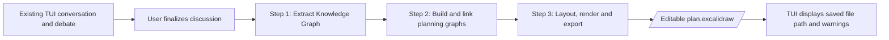

Final export must contain both a **Decision Diagram** and **Implementation Diagram**, with color-coded agent annotations and preserved decision traceability. Annotations must be represented in the file itself (visible notes/markers and/or portable editable elements), so users do not need a custom web frontend to understand the artifact. The renderer must work from the saved knowledge and planning graphs rather than re-interpreting raw transcript text.

**No separate frontend or web service is required.** A React application, embedded Excalidraw editor, interactive canvas, or click-to-navigate UI is explicitly outside scope. Keep everything compatible with the existing TUI and its project language/runtime.

**Implementation status:** This README fully specifies the data-processing side (Steps 1–2), but **does not implement rendering**. Codex completing only the milestone plan below will *not* yet produce the `.excalidraw` file; a minimal Step 3 exporter must be built and integrated for the product to be finished. If Codex is tasked with an end-to-end deliverable rather than Steps 1–2 only, Step 3 must be added as a required milestone, not treated as optional.

### Non-goals for this implementation

- Do not implement the four-agent speaking queue or debate engine. Assume it already exists.
- Do not require agents or the teammate owning the chat storage to attach intent labels, topic tags, or elaborate semantic metadata to every message.
- Do not build an agent-specific metrics/scoring system. There is **no top-level metrics collection**. Extract stated quantities as ordinary fields of constraints/requirements and stated assessments as annotations, if appropriate.
- Do not try to reconstruct private model reasoning; preserve attributable **expressed reasons, arguments, conditions, and evidence**.
- Do not build full Excalidraw drawing/layout **as part of this Step 1–2 implementation**. The overall product still requires an Excalidraw exporter before it is end-to-end complete.
- Do not invent technology choices, acceptance, user decisions, costs, durations, or agent endorsements.
- Do not impose a software-only ontology: software architecture is a major example, but a user's idea may also involve a business, event, creative project, personal goal, etc.

### Principles that must not change accidentally

1. **Canonical source of truth:** Step 1 Knowledge Objects, Annotations, and Relationships.
2. **Independent graph construction:** The Decision Graph and Implementation Graph each read that same source; neither builder requires the other's nodes as input.
3. **Indirect linkage:** Cross-graph associations are derived afterward via **stable Knowledge Object IDs**, not hard-coded graph-node-to-graph-node foreign keys.
4. **One canonical annotation:** Agent reasons live in Step 1; graph nodes contain IDs and direct/inherited association metadata only.
5. **Authority:** A proposal from an agent is not a choice made by the user. Later explicit user changes can supersede earlier ones. Silence is not endorsement.
6. **Provenance:** Extracted claims identify the messages supporting them. Planner-generated additions identify the Step 1 objects that justify them.
7. **Stage boundaries:** Step 1 is descriptive; Step 2 is allowed to synthesize planning details; Step 3 is visual.
8. **Deterministic where possible:** LLMs extract and reason; normal code resolves IDs, links annotations, checks structural invariants, and later draws.

---

# Part I — General flow: TWO processing steps

This is the central design. **Do not add an extra standalone "interpretation" stage between them.** The graph builders may infer the appropriate view as part of building their graphs.

### Mermaid: end-to-end system flow

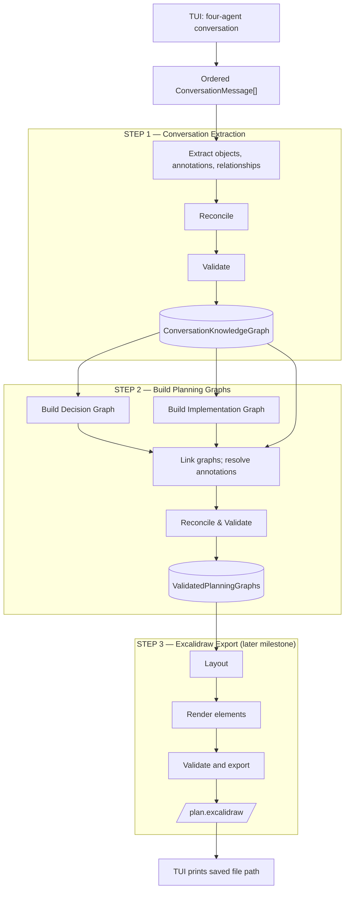

This is the **whole TUI feature**, even though this README's coding milestones primarily specify Steps 1–2. Step 3 is required for the final artifact, not a second interactive frontend.

*The Mermaid diagram above is the authoritative flow; Step 2 builders run independently, and linking waits for both graph outputs.*

**Stage ownership:**

| Process | Primary mechanism | May generate new architecture/tasks? |
|---|---|---|
| Step 1.1 Extract | LLM structured extraction | **No**; only information established in conversation |
| Step 1.2 Reconcile | LLM-assisted or deterministic where unambiguous | **No**; merge and update states |
| Step 1.3 Validate | Deterministic checks; optional semantic audit | **No** |
| Step 2.1A Decision Graph | LLM graph builder | Organization nodes yes; **no invented user decisions** |
| Step 2.1B Implementation Graph | LLM graph builder | **Yes**, labeled as planner-derived or planner-suggested |
| Step 2.2 Link | Deterministic code | **No semantic choices**; resolve already-declared references |
| Step 2.3 Reconcile & Validate | Deterministic rules; optional semantic audit/repair | Repair metadata/invalid graph; don't silently override decisions |
| Future Step 3 | Layout/render code | No new plan logic |

For the MVP, Step 1.1 + 1.2 may be done in **one LLM invocation** returning an already reconciled draft. The logical operations should still be explicit for tests. Step 2.1A/B may run in parallel (separate calls) or one structured call; **linking happens after both graph outputs exist**.

---

# Part II — STEP 1: Conversation Extraction

## Step 1 overview

### Mermaid: Step 1 pipeline

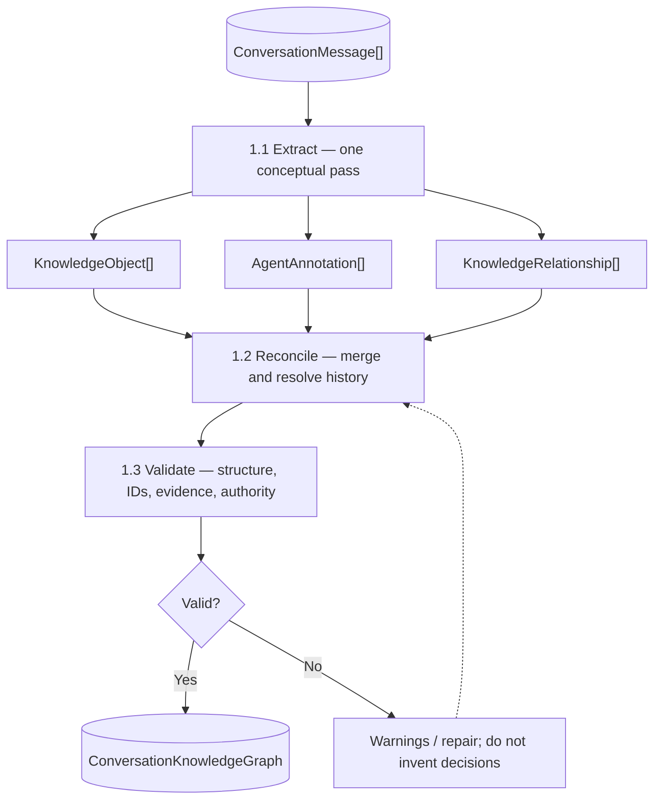

*The Mermaid diagram above defines the Step 1 order. Object, annotation, and relationship extraction happen together.*

### 1.0 Input assumptions and minimal message schema

The conversation has already been split into sequential, attributed messages. We do **not** receive one undifferentiated transcript string, and we do **not** require semantic metadata from the chat engine.

```text
TYPE MessageId = string
TYPE KnowledgeObjectId = string
TYPE AnnotationId = string
TYPE KnowledgeRelationshipId = string
TYPE GraphNodeId = string
TYPE GraphEdgeId = string
TYPE ConversationId = string

ENUM Speaker = user | red | yellow | green | blue | system | other

RECORD ConversationMessage {
  id: MessageId
  sequence: integer                  // strictly increasing, stable
  speaker: Speaker
  content: string                     // required, nonempty unless system event
  timestamp?: ISODateTime             // optional, ordering based on sequence
  replyToMessageId?: MessageId        // optional, use only if already known
}

RECORD ConversationInput {
  conversationId: ConversationId
  messages: List<ConversationMessage>
  snapshotSequence: integer           // last message included; useful for reruns
}
```

Minimum required: `id`, `sequence`, `speaker`, `content`. Preserve original messages unchanged. Sequence—not wall-clock time—defines chronology. Reject duplicates IDs or non-monotonic sequences before calling an LLM.

### 1.1 EXTRACT — three outputs in one conceptual pass

Given the ordered conversation, identify:

1. **Knowledge Objects:** stable concepts such as goals, decisions, proposals, requirements, implementation entities, risks, and questions.
2. **Agent Annotations:** expressed stances, reasoning, conditions, and challenges, attributed to the agent and targeted at an object.
3. **Knowledge Relationships:** typed connections between two knowledge objects.

Extraction may assign **temporary candidate IDs**. Reconciliation later produces canonical IDs and redirects all references. One utterance can support multiple objects; multiple utterances can support one object. Do not create a new object for every message.

### Mermaid: canonical Step 1 data model

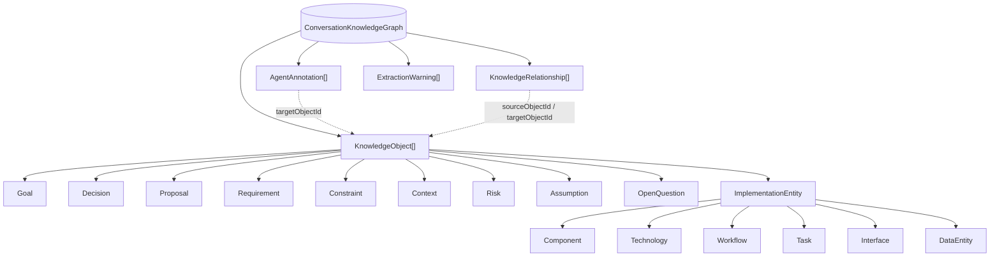

These arrows express **type membership and references**, not a proposed Excalidraw layout. Each annotation targets an existing knowledge object; each knowledge relationship connects two knowledge objects.

### 1.1.1 Shared source/provenance schemas

```text
ENUM KnowledgeOrigin =
  user_explicit
  | agent_explicit
  | conversation_inferred

RECORD SourceRef {
  messageId: MessageId
  // Optional exact passage or span for reviewer/auditor; if used,
  // MUST be taken from that original message, not paraphrased as a quote.
  excerpt?: string
}

RECORD KnowledgeObjectBase {
  id: KnowledgeObjectId
  kind: KnowledgeObjectKind
  title: string
  description: string
  origin: KnowledgeOrigin
  sourceRefs: List<SourceRef>       // generally >= 1 for Step 1 objects
}

ENUM KnowledgeObjectKind =
  goal | requirement | constraint | context_fact | decision | proposal
  | risk | assumption | open_question | implementation_entity
```

`origin` answers **how this item was stated/extracted**, not whether the user approved it. `conversation_inferred` means a *careful interpretation of conversation content*, not a newly invented solution. Unknown facts belong in warnings/questions. Use stable IDs after reconciliation and preserve source references.

### 1.1.2 Project-definition objects

```text
ENUM Priority = critical | high | medium | low | unspecified
ENUM RequirementKind = functional | nonfunctional | quality | policy | other
ENUM RequirementState = confirmed | proposed | deferred | removed
ENUM ConstraintKind = time | budget | people | skill | platform | legal
                    | resource | scope | compatibility | other
ENUM Flexibility = hard | soft | unknown
ENUM FactVerification = user_reported | agent_claimed | externally_verified
                      | unverified | disputed

RECORD Goal EXTENDS KnowledgeObjectBase {
  kind: goal
  priority: Priority
  successCriteria: List<string>     // ONLY if discussed; else []
  state: active | proposed | abandoned | achieved
  parentGoalId?: KnowledgeObjectId
}

RECORD Requirement EXTENDS KnowledgeObjectBase {
  kind: requirement
  requirementKind: RequirementKind
  priority: Priority
  state: RequirementState
  acceptanceCriteria: List<string>  // optional detail, not invented in Step 1
}

RECORD Constraint EXTENDS KnowledgeObjectBase {
  kind: constraint
  constraintKind: ConstraintKind
  flexibility: Flexibility
  expression: string               // e.g. "launch within six weeks"
  value?: number | string          // explicit quantities only
  unit?: string
  appliesToObjectIds: List<KnowledgeObjectId>
}

RECORD ContextFact EXTENDS KnowledgeObjectBase {
  kind: context_fact
  statement: string
  verification: FactVerification
  status: current | disputed | outdated | unknown
}
```

Distinctions: A **goal** is the desired outcome; a **requirement** states what the solution must do; a **constraint** limits the solution space; **context** describes existing circumstances (e.g. there is already a prototype). A user mentioning a possible requirement is not the same as confirming it.

### 1.1.3 Deliberation objects: decisions and proposals

**Model a decision as a question with a resolution, not one object per answer.** For example, “choose a backend framework” is ONE decision, with FastAPI and Django as alternative proposal objects. A user switching from Django to FastAPI should not produce two independent active decisions.

```text
ENUM DecisionCategory = architecture | feature | workflow | strategy
                      | resource | schedule | product | other
ENUM DecisionState = open | resolved | deferred | superseded
ENUM OptionDisposition = selected | explicitly_rejected | not_selected
                       | considered | deferred | withdrawn
ENUM DecisionAuthority = explicit_user | delegated_by_user | not_decided
ENUM ProposalState = active | withdrawn | superseded

RECORD DecisionOptionRef {
  proposalId: KnowledgeObjectId
  disposition: OptionDisposition
  dispositionSourceRefs: List<SourceRef>  // evidence supporting this label
}

RECORD DecisionChange {
  sequence: integer
  selectedProposalId?: KnowledgeObjectId
  changeType: proposed | selected | revoked | deferred | superseded
  authority: DecisionAuthority
  sourceRefs: List<SourceRef>
}

RECORD Decision EXTENDS KnowledgeObjectBase {
  kind: decision
  question: string
  category: DecisionCategory
  state: DecisionState
  options: List<DecisionOptionRef>
  selectedProposalId?: KnowledgeObjectId
  authority: DecisionAuthority
  history: List<DecisionChange>       // chronological important revisions
  unresolvedReason?: string
}

RECORD Proposal EXTENDS KnowledgeObjectBase {
  kind: proposal
  proposedBy: List<Speaker>
  state: ProposalState
  intendedBenefit?: string
  tradeoffs: List<string>           // only expressed in transcript
}
```

Rules:

- `Decision.state = resolved` requires an actual supported selection and decision authority. Do not interpret agent consensus as user acceptance.
- `selectedProposalId` must occur among its `options`; at most one selected option for a single-choice decision. If the conversation genuinely allows multiple choices, model `selectionMode = single | multiple` and `selectedProposalIds` instead; do not quietly pretend they are single-choice. For MVP, use single-choice unless a multi-choice case is clearly supported.
- A proposal can be considered but not selected. **`not_selected` is not equivalent to `explicitly_rejected`.** Only say rejected when the user explicitly rejects it or the decision record authoritatively rules it out.
- `Decision.state = deferred` means the choice was intentionally postponed; `open` means simply unresolved.
- Preserve meaningful revisions in `history` and cite their message sequence numbers. The current selection is the latest authoritative one, not the most mentioned option.
- An agent may retract a proposal without the user rejecting it; `Proposal.state` tracks proposal lifecycle, while the decision's `OptionDisposition` tracks its outcome in a specific choice.
- If there was no substantive choice between alternatives but a user explicitly states "we are using FastAPI," Step 1 may still create a resolved decision with one option, provided the user clearly commits to it.

### 1.1.4 Uncertainty objects

```text
ENUM RiskSeverity = low | medium | high | unknown
ENUM RiskLikelihood = low | medium | high | unknown
ENUM QuestionState = open | answered | deferred
ENUM AssumptionState = unverified | supported | challenged | disproven

RECORD Risk EXTENDS KnowledgeObjectBase {
  kind: risk
  severity: RiskSeverity              // unknown if not stated
  likelihood: RiskLikelihood          // unknown if not stated
  impact: string
  mitigation?: string                 // only if discussion supplied one
  affectedObjectIds: List<KnowledgeObjectId>
}

RECORD Assumption EXTENDS KnowledgeObjectBase {
  kind: assumption
  statement: string
  state: AssumptionState
  validationNeeded?: string
}

RECORD OpenQuestion EXTENDS KnowledgeObjectBase {
  kind: open_question
  question: string
  state: QuestionState
  blocking: true | false | unknown
  relatedObjectIds: List<KnowledgeObjectId>
  answerSourceRefs: List<SourceRef>   // present if answered
}
```

Do not confuse **risk** (something that may go wrong), **assumption** (something believed without proof), and **open question** (something no one has resolved). These serve different purposes in Step 2.

### 1.1.5 Implementation entities — explicitly discussed ONLY

Step 1 can extract a component or workflow whether or not it was formally debated. It does **not** fill out missing architecture yet. Subtypes follow the previously agreed ontology; `interface` and `data_entity` can be sparsely supported initially but should be representable in the schema.

```text
ENUM ImplementationSubtype = component | technology | workflow
                            | interface | task | data_entity
ENUM AdoptionState = confirmed | proposed | rejected | deferred | superseded

RECORD ImplementationEntityBase EXTENDS KnowledgeObjectBase {
  kind: implementation_entity
  subtype: ImplementationSubtype
  adoptionState: AdoptionState
  // "user_explicit" != automatically confirmed; confirmation requires intent.
}

RECORD ComponentEntity EXTENDS ImplementationEntityBase {
  subtype: component
  responsibility?: string
  boundaryDescription?: string
}

RECORD TechnologyEntity EXTENDS ImplementationEntityBase {
  subtype: technology
  technologyName: string
  version?: string                  // ONLY if explicitly discussed
  intendedUse?: string
}

RECORD WorkflowStep {
  stepId: string
  label: string
  order: integer
  actorOrComponentId?: KnowledgeObjectId
  sourceRefs: List<SourceRef>
}

RECORD WorkflowEntity EXTENDS ImplementationEntityBase {
  subtype: workflow
  trigger?: string
  steps: List<WorkflowStep>         // discussed steps only
  outcome?: string
}

RECORD InterfaceEntity EXTENDS ImplementationEntityBase {
  subtype: interface
  contractType?: api | event | message | data_exchange | other
  protocol?: string
  endpointOrTopic?: string
}

RECORD TaskEntity EXTENDS ImplementationEntityBase {
  subtype: task
  intendedAction: string
  owner?: string                    // only if assigned in conversation
  explicitlyStatedDeadline?: string
  completionState: proposed | committed | in_progress | done | cancelled
}

RECORD DataEntity EXTENDS ImplementationEntityBase {
  subtype: data_entity
  dataDescription?: string
  fieldsMentioned: List<string>
  storageOrFormat?: string
}

TYPE ImplementationEntity =
  ComponentEntity | TechnologyEntity | WorkflowEntity |
  InterfaceEntity | TaskEntity | DataEntity

TYPE KnowledgeObject =
  Goal | Requirement | Constraint | ContextFact | Decision | Proposal |
  Risk | Assumption | OpenQuestion | ImplementationEntity
```

**Extraction examples:**

- “Users enter an idea through React” → requirement (idea submission), component (frontend), technology (React), perhaps workflow (idea submission) as supported.
- “Use FastAPI instead of Django” → decision + option proposals + a technology entity if meaningful. The decision and technology are **different objects**.
- “Blue recommends persistent storage” → proposal or proposed data component, not an accepted implementation.
- “Build the speaking queue next” → explicitly discussed task; Step 2 may later break it into smaller derived tasks.
- “Frontend calls backend” → two components and a `communicates_with` knowledge relationship; **not** necessarily a defined API interface object unless a contract was discussed.

### 1.1.6 Agent annotations — standalone canonical records

Agent annotations capture **what an agent actually expressed** about a knowledge object. They are neither decision objects nor four required fields on every decision. Agents may annotate proposals, decisions, requirements, risks, components, or workflows. There may be zero, one, or many annotations from each agent.

```text
ENUM AgentId = red | yellow | green | blue
ENUM Stance = support | oppose | conditional | neutral | concern | question
ENUM AnnotationState = current | revised | withdrawn

RECORD AgentAnnotation {
  id: AnnotationId
  agent: AgentId
  targetObjectId: KnowledgeObjectId
  stance: Stance
  reasoning: string                 // concise faithful paraphrase of expressed view
  conditions: List<string>          // explicit qualifications, if any
  sourceRefs: List<SourceRef>       // MUST be attributable to that agent
  state: AnnotationState
  revisesAnnotationId?: AnnotationId
}
```

Rules:

- Never fabricate an endorsement because an agent did not object.
- “Blue preferred Django earlier but later conditionally accepted SQLite” may produce separate time-aware annotations, linked by `revisesAnnotationId`; reconciliation must not erase meaningful history.
- Prefer an annotation on the *specific proposal* (“FastAPI”) when the view concerns that choice, rather than a vague annotation on the whole “backend choice” decision.
- When an agent's statement concerns an interaction between two objects, an MVP may keep evidence on the knowledge relationship or represent the concern as a constraint/risk with an annotation. **No edge-level agent annotation model is required now.**
- Ratings such as “low effort” can remain in `reasoning` or `conditions` if expressed. Do not invent a numeric assessment or introduce a compulsory metrics schema.

### 1.1.7 Knowledge relationships — object-to-object only for the MVP

A knowledge relationship connects two canonical **knowledge objects**. Annotations connect to objects through `targetObjectId`, so they do not need to masquerade as object-object edges.

```text
ENUM KnowledgeRelation =
  part_of | supports | conflicts_with | constrains | satisfies
  | depends_on | selects | rejects | addresses | implements
  | uses | communicates_with | precedes | produces | affects

ENUM RelationshipOrigin = user_explicit | agent_explicit | conversation_inferred

RECORD KnowledgeRelationship {
  id: KnowledgeRelationshipId
  sourceObjectId: KnowledgeObjectId
  targetObjectId: KnowledgeObjectId
  relation: KnowledgeRelation
  origin: RelationshipOrigin
  sourceRefs: List<SourceRef>
  description?: string
}
```

Some relationships may later become graph edges; others exist only as provenance or justification. `selects` from Decision → Proposal should agree with the current Decision selection. `depends_on` must document which object depends on which. Do not add relations merely because titles contain similar words.

### 1.1.8 Extraction warnings and output envelope

```text
ENUM WarningSeverity = info | warning | error
ENUM WarningKind = ambiguity | contradiction | unsupported_claim
                 | missing_information | invalid_reference | incomplete_extraction
                 | other

RECORD ExtractionWarning {
  id: string
  kind: WarningKind
  severity: WarningSeverity
  message: string
  relatedObjectIds: List<KnowledgeObjectId>
  sourceRefs: List<SourceRef>
}

RECORD ConversationKnowledgeGraph {
  schemaVersion: string
  conversationId: ConversationId
  snapshotSequence: integer
  objects: List<KnowledgeObject>
  annotations: List<AgentAnnotation>
  relationships: List<KnowledgeRelationship>
  warnings: List<ExtractionWarning>
}
```

Choose **one canonical `objects` collection containing discriminated types** internally. Accessor functions can still expose `objectsByKind` or filtered lists. This avoids maintaining duplicate copies of the same object in both a flat list and per-kind arrays.

## 1.2 RECONCILE — consolidate without rewriting history

**Purpose:** Reconciliation is more than removing duplicate rows. It identifies different references to the same underlying concept, resolves the current status based on the conversation's chronology and authority, and remaps all related annotation/relationship references to canonical IDs.

### 1.2.1 Candidate → canonical reconciliation rules

1. **Normalize identity:** "the server", "our backend", and "the API" may refer to one backend component *if context actually supports that*. Do not merge separate API gateway and application-server components merely because both are "backend".
2. **Merge concept duplicates:** Multiple discussions of "database selection" become ONE canonical decision question; preserve all relevant sources and options.
3. **Distinguish related but nonidentical concepts:** "Use FastAPI" as a decision, "FastAPI" as a technology, and "Backend API" as a component should remain distinct, linked entities.
4. **Resolve choice chronology:** An earlier explicit Django selection followed by a later explicit FastAPI selection for the same purpose means the **current** decision is FastAPI and earlier Django is superseded in history.
5. **Honor authority:** Agent proposals/consensus do not override explicit user decisions. If the user delegates a choice, record evidence for that delegation. An ambiguous “sounds good” should not automatically resolve multiple concurrent topics.
6. **Preserve changes:** A change in an agent's opinion may update its current stance while retaining earlier annotations and the link explaining the revision.
7. **Update references:** Every `targetObjectId`, `proposalId`, `sourceObjectId`, `targetObjectId`, `parentGoalId`, and relevant embedded object reference must point at the canonical object after merges.
8. **Warn rather than force:** If it is unclear whether two candidate objects refer to the same thing, retain both and emit an ambiguity warning.

### 1.2.2 Reconciliation pseudocode

```text
FUNCTION reconcile(candidateGraph, orderedMessages):
  mappings = new Map<KnowledgeObjectId, KnowledgeObjectId>()
  canonicalObjects = []

  FOR EACH candidateObject IN candidateGraph.objects BY source chronology:
    match = findSemanticallyEquivalentCanonicalObject(candidateObject, canonicalObjects)
    IF match is strong AND no category/semantic conflict:
      mergeCompatibleFields(match, candidateObject)
      mergeAndDeduplicateSourceRefs(match, candidateObject)
      mappings[candidateObject.id] = match.id
    ELSE:
      canonicalObjects.add(candidateObject)
      mappings[candidateObject.id] = candidateObject.id

  remapAllKnowledgeObjectReferences(candidateGraph, mappings)
  collapseSemanticallyDuplicateRelationships(candidateGraph.relationships)
  resolveDecisionSnapshotsFromChronologyAndAuthority(canonicalObjects, orderedMessages)
  reconcileAnnotationRevisions(candidateGraph.annotations)
  preserveImportantDecisionChangeHistory(canonicalObjects)
  flagAmbiguousMappingsAndUnresolvedContradictions(candidateGraph)

  RETURN ConversationKnowledgeGraph(
    objects = canonicalObjects,
    annotations = candidateGraph.annotations,
    relationships = candidateGraph.relationships,
    warnings = candidateGraph.warnings
  )
```

The semantic matching and chronological interpretation can be done by the extraction LLM in the same initial call for the MVP. Keep the functions conceptually separate in code so you can evaluate and eventually split them. Deterministic ID remapping, duplicate edge cleanup, and stable ordering should be implemented with normal code.

### 1.2.3 Authority and explicitness examples

| Transcript | Correct extraction | Incorrect extraction |
|---|---|---|
| “Red thinks SQLite is best” | Proposal + Red annotation | Accepted decision |
| “Let's use SQLite” (user) | Resolved decision selecting SQLite | Merely an unconfirmed proposal |
| “Maybe SQLite” (user) | Preference/proposal, unresolved | Confirmed commitment |
| “Actually use PostgreSQL” (later user) | Same decision now selects PostgreSQL; SQLite past history | Two active resolved DB decisions |
| “Blue agrees if it scales” | Conditional annotation with condition | Unconditional endorsement |
| “We don't need login for the first release” | Negative scope requirement/decision if clearly committed | Login task added as confirmed in Step 2 |

## 1.3 VALIDATE — what must be checked and why

Validation runs **after reconciliation**, since merges and redirects can create dangling references. Parser-level validation may also run before reconciliation to ensure the initial draft is well-formed; that is a safeguard, not a fourth logical stage.

### 1.3.1 Structural validation (mandatory, deterministic)

- `schemaVersion` is supported; required fields/types are present.
- Every object, annotation, and relationship ID is unique in its namespace.
- Every `SourceRef.messageId` exists in the exact input conversation snapshot.
- Every relationship endpoint is a valid object ID.
- Every annotation's `targetObjectId` exists.
- Every annotation source belongs to the attributed agent (e.g. no Blue annotation citing solely a Red message).
- Every `selectedProposalId` and proposal in `Decision.options` refers to an existing Proposal object.
- A resolved single-choice decision has exactly one selected option, with evidence of appropriate authority.
- Any supersession/revision pointer points to a real prior record and does not form a cycle.
- Workflow step IDs are unique inside their workflow; ordered steps are well-defined.
- `Risk.severity = high` and similar judgments are *not silently filled in* if no supporting assessment was actually expressed.
- Cross-references inside specialized objects (`affectedObjectIds`, `parentGoalId`, etc.) are valid.
- For Step 1, no object should claim to be a newly designed solution without a supporting transcript source.

### 1.3.2 Semantic validation (optional MVP, recommended for evaluation)

Programmatic checks cannot ensure the cited text actually supports the interpretation. A semantic auditor—possibly another LLM pass—can examine *especially consequential claims*:

- Did the user really choose the selected option?
- Is a purported agent stance supported by that agent's words?
- Did we merge two concepts incorrectly?
- Did the extractor mark a contested assertion as an established fact?
- Did we overlook a later revision?

Use a high threshold for claims of **user acceptance**. On uncertainty, keep the decision `open` or `deferred` and emit a warning.

### 1.3.3 Error handling policy

```text
FUNCTION validateKnowledgeGraph(graph, conversation):
  errors = []
  warnings = graph.warnings

  errors += validateSchema(graph)
  errors += validateUniqueIds(graph)
  errors += validateReferences(graph, conversation)
  errors += validateDecisionStateInvariants(graph)
  errors += validateSpeakerAttribution(graph, conversation)
  errors += validateRevisionChains(graph)

  IF errors contains fixable mechanical errors:
    attemptDeterministicRepairWhereUnambiguous()
    revalidate()

  IF hard errors remain:
    RETURN ValidationFailure(errors, warnings)

  RETURN ValidatedConversationKnowledgeGraph(graph, warnings)
```

A limited structured regeneration/repair pass may be used if an LLM response violates the schema, but **never fix an unsupported decision by inventing evidence**. Report uncertainty and allow the downstream planner to work with explicitly unresolved information.

### 1.3.4 Step 1 output contract

```text
STEP1_OUTPUT = {
  knowledgeGraph: ConversationKnowledgeGraph,
  validationReport: ValidationReport
}

RECORD ValidationIssue {
  code: string
  severity: info | warning | error
  message: string
  objectOrGraphIds: List<string>
}

RECORD ValidationReport {
  passed: boolean
  issues: List<ValidationIssue>
}
```

### 1.4 Step 1 prompt contract for the extracting LLM

The extractor's **system/developer instruction** should explicitly say:

```text
You are an evidence-grounded conversation knowledge extractor.
Given ordered speaker-attributed messages, return objects, agent annotations,
object relationships and warnings conforming to the supplied schema.

- Read the whole conversation, including later corrections.
- Create one canonical decision question rather than duplicates per option.
- Record explicit user commitments as decisions only when truly supported.
- An agent suggestion is not a user selection.
- Separate decisions, proposals, implementation entities, requirements,
  constraints, context facts, risks, assumptions and unresolved questions.
- Preserve agent opinions only when agents actually expressed them.
- Attribute each annotation to the correct agent and source message.
- Record relationships only if grounded in the conversation.
- Do not expand a partial architecture or invent tasks.
- Use structured fields and exact message references; return no prose outside schema.
- Report ambiguity instead of fabricating a final choice.
```

**Operational note:** Passing all messages at once is the easiest MVP. For large conversations, use chunks with overlapping context, then a global reconciliation pass that sees ordered summary/history and original cited passages. Never reconcile chronological decisions from a context window that excludes their later revisions.

---

# Part III — STEP 2: Build TWO Planning Graphs

## Step 2 overview (agreed, fixed order)

### Mermaid: Step 2 pipeline

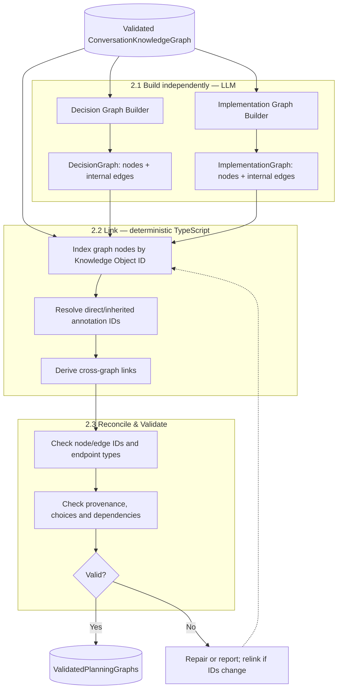

The two graph builders may execute concurrently; **2.2 cannot execute until both graphs exist**. Graph-internal edges are made during 2.1, while cross-graph links and annotation references are derived in 2.2.

*The Mermaid diagram above defines the Step 2 order. Each builder creates its own internal edges; links and annotation references are resolved afterward.*

### Step 2 responsibilities

- **Decision Graph:** primarily organize Step 1 decisions/proposals into a comprehensible hierarchy and display paths to their existing reasoning; may add grouping nodes, but **must not manufacture new user decisions**.
- **Implementation Graph:** reuse existing implementation entities, then synthesize necessary components, workflows, interfaces, tasks, milestones and dependencies appropriate to the project type. Distinguish confirmed inputs, logical derivations and optional recommendations.
- **Link stage:** deterministic TypeScript; no LLM required. Use explicit knowledge IDs, not natural-language title similarity.
- **Validation:** verify that planning additions do not contradict accepted decisions or turn undecided options into accepted ones.

## 2.1 Shared graph primitives — schemas

### Mermaid: shared nodes, edges and annotation references

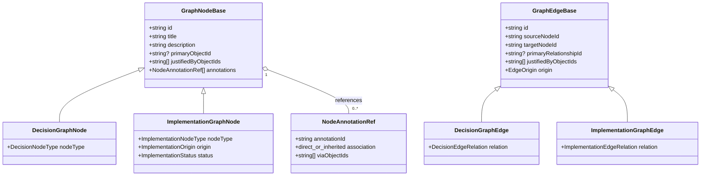

`NodeAnnotationRef` contains IDs and an association type, **not copied agent reasoning**. Graph builders leave this list empty; the TypeScript linker populates it from canonical Step 1 annotations.

**There are THREE different identity layers:**

1. `KnowledgeObjectId` — stable canonical concept in Step 1; authoritative for meaning.
2. `GraphNodeId` — node representing or synthesizing a concept in a specific graph.
3. `ExcalidrawElementId` — future drawing element ID; not introduced until Step 3.

Graph nodes and edges are logical, **not** coordinate-bearing drawing primitives.

```text
ENUM NodeAnnotationAssociation = direct | inherited

RECORD NodeAnnotationRef {
  annotationId: AnnotationId
  association: NodeAnnotationAssociation
  // For inherited annotations, records the justification object(s)
  // through which this annotation was discovered.
  viaObjectIds: List<KnowledgeObjectId>
}

RECORD GraphNodeBase {
  id: GraphNodeId
  title: string
  description: string

  // The Step 1 object this node directly depicts, if any.
  // null for organizational groups and genuinely new planner-derived nodes.
  primaryObjectId?: KnowledgeObjectId

  // Step 1 objects motivating this node or its configuration.
  // Keep separate from primaryObjectId: REPRESENTS vs JUSTIFIED BY.
  justifiedByObjectIds: List<KnowledgeObjectId>

  // Initially [] from LLM graph builders; populated by 2.2 linker.
  annotations: List<NodeAnnotationRef>
}

ENUM EdgeOrigin = conversation_explicit | knowledge_derived | planner_derived

RECORD GraphEdgeBase {
  id: GraphEdgeId
  sourceNodeId: GraphNodeId
  targetNodeId: GraphNodeId
  primaryRelationshipId?: KnowledgeRelationshipId
  justifiedByObjectIds: List<KnowledgeObjectId>
  origin: EdgeOrigin
  description?: string
}
```

**No agent reasoning strings are duplicated in either graph.** The graph node contains annotation IDs with how they were associated; all agent text, stances, and message citations live in the canonical Step 1 annotation records.

### 2.1A Decision Graph node schemas

```text
ENUM DecisionNodeType = group | decision | option

RECORD DecisionGraphNode EXTENDS GraphNodeBase {
  nodeType: DecisionNodeType
}

ENUM DecisionEdgeRelation = contains | has_option | depends_on | influences

RECORD DecisionGraphEdge EXTENDS GraphEdgeBase {
  relation: DecisionEdgeRelation
}

RECORD DecisionGraph {
  nodes: List<DecisionGraphNode>
  edges: List<DecisionGraphEdge>
}
```

**Node mapping:**

| Node | `primaryObjectId` | Typical `justifiedByObjectIds` | Notes |
|---|---|---|---|
| `group` | absent | optional goal/requirement context | Organizer, not a new decision |
| `decision` | Decision object ID | constraints/goals/requirements affecting it | Status and selection are read from canonical Decision |
| `option` | Proposal object ID | optional relevant constraints | Option's selected/rejected/considered status is read from the parent Decision's `options` |

The graph builder must not generate a node saying “Red supported X” as if it were a decision; agent views are annotations on the relevant knowledge objects. The decision node should not duplicate the accepted choice/state; the renderer can look that up in Step 1 or a later display projection.

**Decision edges — exact semantics and intended endpoints:**

| Relation | Valid source → target | Semantics | Allowed origin |
|---|---|---|---|
| `contains` | group → group/decision | Organization hierarchy | Planner-derived permitted |
| `has_option` | decision → option | Decision considers proposal | Must come from `Decision.options` |
| `depends_on` | decision → decision | Source decision *cannot be resolved/acted on until* target decision | Only when supported; don't infer casually |
| `influences` | decision → decision | Source decision materially affects target choice | Ground in Step 1, do not use merely for topical similarity |

**Direction matters**: `A depends_on B` means A depends on B. `A influences B` means A affects B. `has_option` always points from decision to option. Avoid generic unlabeled connectors.

### 2.1B Implementation Graph node schemas

```text
ENUM ImplementationNodeType =
  group | component | technology | workflow | task |
  interface | data_entity | milestone

ENUM PlanOrigin =
  conversation_explicit
  | decision_derived
  | planner_derived
  | planner_suggested

ENUM PlanStatus = confirmed | proposed | undecided | deferred

RECORD ImplementationGraphNode EXTENDS GraphNodeBase {
  nodeType: ImplementationNodeType
  origin: PlanOrigin
  status: PlanStatus
}

ENUM ImplementationEdgeRelation =
  contains | uses | communicates_with | depends_on |
  implements | precedes | produces

RECORD ImplementationGraphEdge EXTENDS GraphEdgeBase {
  relation: ImplementationEdgeRelation
}

RECORD ImplementationGraph {
  nodes: List<ImplementationGraphNode>
  edges: List<ImplementationGraphEdge>
}
```

We add `milestone` as a **Step 2 planning node**, not an additional required Step 1 implementation-entity subtype. If a milestone was explicitly discussed, Step 1 can capture it in a goal/task/constraint with sources; Step 2 can present it as a milestone node.

**Important semantic rules:**

- `conversation_explicit` means directly described or chosen in the discussion. It is **not automatically** `confirmed`; approval and origin are distinct.
- `decision_derived` means an accepted decision justifies the node/configuration. Reference that canonical Decision ID.
- `planner_derived` means a necessary/logical elaboration added by Step 2. Does NOT pretend to be user-approved.
- `planner_suggested` means a discretionary recommendation; usually `status = proposed`.
- `confirmed` should be reserved for explicitly adopted/specified elements or logically mandatory consequences of confirmed requirements with no outstanding choice. Where doubt exists, use `proposed` or `undecided`.
- Unresolved technology selection can yield a confirmed generic **storage capability** but `undecided` specific technology; do not silently choose PostgreSQL/SQLite.
- Some domains may not require a software architecture. A `component` can denote part of a broader solution; `workflow`, `task`, and `milestone` will often carry most of the plan.

**Implementation edges — initial endpoint guidelines:**

| Relation | Typical source → target | Meaning |
|---|---|---|
| `contains` | group/component → group/component/task/etc. | Structural or logical hierarchy; no containment cycles |
| `uses` | component/workflow → technology/data_entity | Source uses target |
| `communicates_with` | component/interface → component/interface | Source initiates communication toward target |
| `depends_on` | task/milestone/component → task/milestone/component | Source requires target to be available/completed |
| `implements` | task → component/workflow/interface | Task realizes target functionality |
| `precedes` | workflow/task/milestone → workflow/task/milestone | Source occurs before target |
| `produces` | workflow/component/task → data_entity/component | Source produces target artifact/result |

Treat this matrix as an **allowlist with sensible extension points**, not license to connect every type to everything. If an edge is better modeled as a different relation, use the accurate relation.

- Workflow steps within a `WorkflowEntity` are Step 1 extracted details; the Implementation Graph can synthesize workflow stages where needed.
- For MVP, `communicates_with` is directed: source initiates a communication. If truly bidirectional and the distinction matters, explicitly model both directions or add a documented bidirectional flag; don't casually assume it.
- `depends_on` task dependency graphs should generally be acyclic; any cycle is an implementation blocker unless clearly modeled as an iterative process rather than prerequisites.
- Graph builders create **internal edges during 2.1**; the 2.2 linker does not invent internal graph topology.
- Every derived edge must identify its origin and any supporting knowledge objects. A generated implementation dependency can be `planner_derived`.

### 2.1C Graph building pseudocode

```text
FUNCTION buildDecisionGraph(knowledgeGraph):
  decisions = knowledgeGraph.objects.filter(kind == decision)
  proposals = knowledgeGraph.objects.filter(kind == proposal)
  relevantGoalsAndConstraints = selectContext(knowledgeGraph)

  graph = LLM_GENERATE_DECISION_GRAPH(
    decisions,
    proposals,
    relevantGoalsAndConstraints,
    knowledgeGraph.relationships,
    knowledgeGraph.annotations,
    schema = DecisionGraph
  )

  // LLM fills IDs, primaryObjectId, justifiedByObjectIds, nodes, edges.
  // It leaves node.annotations = [] (resolved in 2.2).
  // No invented decisions or phantom user approvals.
  RETURN graph

FUNCTION buildImplementationGraph(knowledgeGraph):
  acceptedDecisions = selectAuthoritativeResolutions(knowledgeGraph)
  implementationEntities = selectExistingImplementationEntities(knowledgeGraph)
  requirementsAndGoals = selectGoalsRequirementsConstraints(knowledgeGraph)
  openChoicesAndRisks = selectUnresolvedAndRisks(knowledgeGraph)

  graph = LLM_GENERATE_IMPLEMENTATION_GRAPH(
    acceptedDecisions,
    implementationEntities,
    requirementsAndGoals,
    openChoicesAndRisks,
    knowledgeGraph.relationships,
    knowledgeGraph.annotations,
    schema = ImplementationGraph
  )

  // LLM can add justified planner-derived nodes and internal edges.
  // It leaves node.annotations = []. It does not use DecisionGraph IDs.
  RETURN graph

FUNCTION buildBothGraphs(knowledgeGraph):
  decisionGraph, implementationGraph = RUN_CONCURRENTLY(
    buildDecisionGraph(knowledgeGraph),
    buildImplementationGraph(knowledgeGraph)
  )
  RETURN (decisionGraph, implementationGraph)
```

The LLM may read the annotations to assess what was discussed, but must not synthesize new agent opinions into the graph. Its outputs should conform to constrained structured schemas, with low randomness where the model provider supports that.

## 2.2 LINK GRAPHS — deterministic associations, not extra LLM reasoning

The two graph builders are independent. They do **not** reference each other's node IDs. Each graph node already carries the canonical Step 1 IDs describing what it represents (`primaryObjectId`) or why it exists (`justifiedByObjectIds`). **Linking is where those references become actionable.**

Step 2.2 has two distinct jobs:

1. Populate each graph node's `annotations` list with **direct** or **inherited** `NodeAnnotationRef` entries.
2. Construct a derived **cross-graph link index** based on shared knowledge-object references.

### Mermaid: deterministic annotation resolution and cross-graph linking

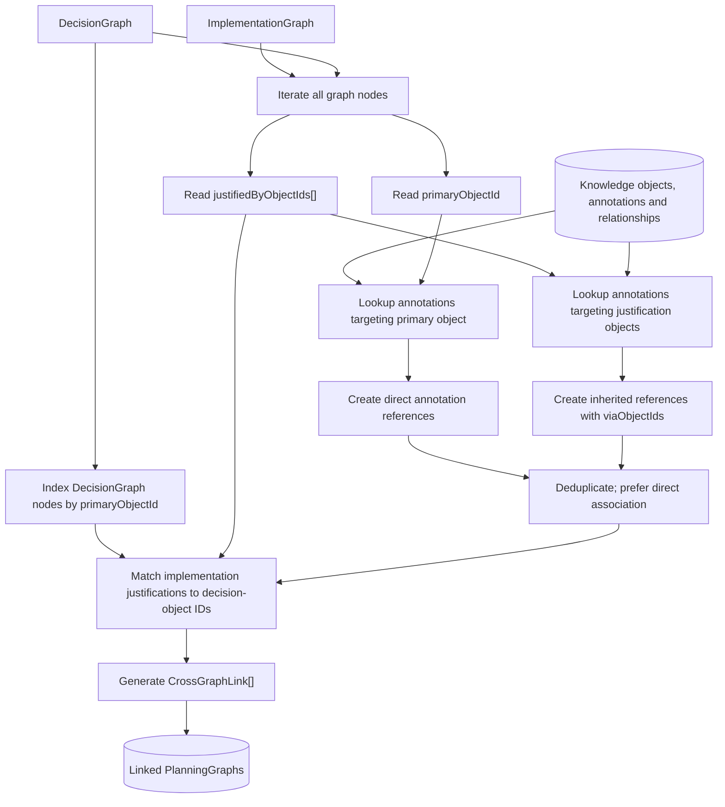

No title matching and no second LLM judgment is required. A `DecisionGraphNode` typically gets **direct** annotations on its primary decision/proposal; an `ImplementationGraphNode` may get direct annotations on its represented component and **inherited** notes via its explicit justifications. Inheritance does **not** imply that the agent endorsed the entire implementation node.

### 2.2.1 Direct vs inherited annotations

- **Direct:** an annotation's `targetObjectId` equals the node's `primaryObjectId`.
- **Inherited:** an annotation targets one of the node's `justifiedByObjectIds`.
- **No automatic multi-hop propagation:** don't traverse every knowledge relationship and attach all nearby opinions. This causes irrelevant inherited annotations.
- **No implied agent support:** inherited means “relevant reasoning via an associated decision/requirement,” **not** “this agent approves the whole architecture component.”
- **Zero annotations is valid.** A group heading need not inherit dozens of project-wide opinions merely because it organizes a project.
- Prefer direct over inherited for the *same annotation ID*. If one annotation was found by multiple justification IDs, preserve all `viaObjectIds` without duplicating it.

**Illustration:**

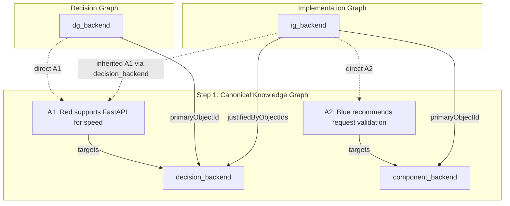

**When do we populate them?** **Only now**, in Step 2.2. The graph-building LLMs can consult agent annotations for context, but graph nodes are emitted with `annotations: []`. Do not pay the LLM to build annotation indexes it cannot reliably verify.

### 2.2.2 Annotation resolution pseudocode

```text
FUNCTION indexAnnotationsByTarget(annotations):
  index = Map<KnowledgeObjectId, List<AgentAnnotation>>()
  FOR EACH annotation IN annotations:
    index[annotation.targetObjectId].append(annotation)
  RETURN index

FUNCTION resolveNodeAnnotations(node, annotationIndex):
  // Group nodes normally have no attached notes unless they represent a
  // meaningful canonical object. This avoids high-volume inherited noise.
  IF node.nodeType == group AND node.primaryObjectId is absent:
    RETURN []

  byAnnotationId = Map<AnnotationId, NodeAnnotationRef>()

  IF node.primaryObjectId exists:
    FOR EACH a IN annotationIndex[node.primaryObjectId]:
      byAnnotationId[a.id] = {
        annotationId: a.id,
        association: direct,
        viaObjectIds: []
      }

  FOR EACH knowledgeId IN unique(node.justifiedByObjectIds):
    FOR EACH a IN annotationIndex[knowledgeId]:
      IF byAnnotationId[a.id] exists AND association == direct:
        CONTINUE
      IF byAnnotationId[a.id] exists:
        add knowledgeId to existing viaObjectIds
      ELSE:
        byAnnotationId[a.id] = {
          annotationId: a.id,
          association: inherited,
          viaObjectIds: [knowledgeId]
        }

  RETURN stableSortAndDeduplicate(byAnnotationId.values)

FUNCTION attachAnnotationsToBothGraphs(decisionGraph, implementationGraph, knowledgeGraph):
  index = indexAnnotationsByTarget(knowledgeGraph.annotations)
  FOR EACH node IN decisionGraph.nodes + implementationGraph.nodes:
    node.annotations = resolveNodeAnnotations(node, index)
```

The renderer will later decide whether to show the current position, historical notes, or only a few important opinions. **Do not remove older canonical annotations just to simplify the graph.**

### 2.2.3 Linking Decision ↔ Implementation Graphs

**Why link at all if both know the Knowledge Graph?** The knowledge graph is sufficient for semantic context. The derived index makes navigation, traceability, highlight-on-selection, and future impact analysis efficient, without adding graph-to-graph dependencies to either builder.

Examples:

- Selecting “Backend API” in an eventual implementation view can show the “Choose backend framework” decision and relevant agent reasoning.
- Revising a decision can identify implementation nodes that cite it and may need recomputation.
- A task can cite several decisions and goals; it need not belong under one arbitrary decision node.

#### Cross-graph link schema

```text
ENUM CrossLinkKind = primary_shared_object | justification

RECORD CrossGraphLink {
  decisionNodeId: GraphNodeId
  implementationNodeId: GraphNodeId
  viaKnowledgeObjectId: KnowledgeObjectId
  kind: CrossLinkKind
}

RECORD CrossGraphLinkIndex {
  links: List<CrossGraphLink>
  // These indexes may be derived at runtime rather than persisted.
  byDecisionNodeId: Map<GraphNodeId, List<CrossGraphLink>>
  byImplementationNodeId: Map<GraphNodeId, List<CrossGraphLink>>
}
```

#### Simple linking algorithm (recommended MVP)

```text
FUNCTION deriveCrossGraphLinks(decisionGraph, implementationGraph):
  decisionNodeIndex = Map<KnowledgeObjectId, List<GraphNodeId>>()

  FOR EACH dNode IN decisionGraph.nodes:
    IF dNode.primaryObjectId exists:
      decisionNodeIndex[dNode.primaryObjectId].append(dNode.id)

  links = Set<(decisionNodeId, implementationNodeId, viaKnowledgeObjectId, kind)>()

  FOR EACH iNode IN implementationGraph.nodes:
    IF iNode.primaryObjectId exists:
      FOR EACH dNodeId IN decisionNodeIndex[iNode.primaryObjectId]:
        links.add(dNodeId, iNode.id, iNode.primaryObjectId, primary_shared_object)

    FOR EACH objectId IN iNode.justifiedByObjectIds:
      FOR EACH dNodeId IN decisionNodeIndex[objectId]:
        links.add(dNodeId, iNode.id, objectId, justification)

  RETURN buildCrossGraphLinkIndex(links)
```

`viaKnowledgeObjectId` explains exactly why the association exists. No title matching. No extra LLM call. A node can have multiple decision links. An implementation node may legitimately have **no corresponding Decision Graph node** because it is justified only by requirements, constraints, or other implementation entities.

**Optional future enhancement — indirect linking:** If `decision_D` selects `proposal_P`, `component_C` uses `technology_T`, and the knowledge relationships explicitly connect the selection to the technology, graph-level impact can be computed through a **controlled typed relationship traversal** (with allowed relation paths and path-length bounds). Do not include arbitrary graph traversal in the MVP: it risks spurious cross-links. For the initial system, prefer explicitly recording the decision as a justification on implementation nodes when it materially affects them.

### 2.2.4 Complete linking pseudocode

```text
FUNCTION linkPlanningGraphs(knowledgeGraph, decisionGraph, implementationGraph):
  attachAnnotationsToBothGraphs(decisionGraph, implementationGraph, knowledgeGraph)
  crossGraphLinks = deriveCrossGraphLinks(decisionGraph, implementationGraph)
  RETURN {
    decisionGraph,
    implementationGraph,
    crossGraphLinks
  }
```

**Important:** `GraphEdge` objects within each graph were already created during Step 2.1. The Step 2.2 linker does not add `depends_on`, `contains`, `uses`, or `has_option` edges. It creates **cross-graph associations** as a separate index and resolves annotation references.

## 2.3 RECONCILE & VALIDATE — correctness before rendering

This is the last step before handing graph data to a visual renderer.

### 2.3.1 Reconciliation within each graph

- Consolidate accidental duplicate graph nodes representing the same Step 1 object in the same role, unless deliberate multiple appearances are explicitly supported as separate presentation instances.
- Deduplicate edges with the same `(sourceNodeId, relation, targetNodeId)` meaning.
- Ensure grouping is coherent (a node should not get contradictory primary parents unless DAG-style multi-parent organization is explicitly intended).
- Preserve distinct architectural concepts even if their titles look similar.
- Repair graph IDs and affected edge endpoints when safe.
- If changes affect node IDs or knowledge references, **re-run the deterministic linking operation**, then validate again. This does not reverse the conceptual pipeline; it is an error-repair loop inside 2.3.

### 2.3.2 Common node invariants

- Unique graph node IDs within each graph; GraphEdge endpoints must exist in that same graph.
- `primaryObjectId` and all `justifiedByObjectIds` exist in the canonical Knowledge Graph.
- `primaryObjectId` points to the correct object kind for that node type:
  - `DecisionGraphNode.decision` → Decision object.
  - `DecisionGraphNode.option` → Proposal object.
  - Implementation node subtype → matching Step 1 ImplementationEntity when `primaryObjectId` refers to an entity; for a synthesized node it may be absent.
- Each `NodeAnnotationRef.annotationId` exists; direct refs target `primaryObjectId`; inherited refs target one of the listed `viaObjectIds` and those IDs belong to `justifiedByObjectIds`.
- `Group` nodes with no `primaryObjectId` should not claim inherited comments about everything they contain.
- No copied agent reasoning is invented in node descriptions. Node titles/descriptions can summarize intended design, not attribute claims to absent sources.
- A newly derived implementation node has honest `origin` and `status` values and meaningful justification IDs whenever possible.

### 2.3.3 Decision Graph invariants

- Every `has_option` edge goes Decision → Option and agrees with that Decision knowledge object's options.
- `contains` edges form an acyclic organizational hierarchy.
- `depends_on` and `influences` have Decision → Decision endpoints.
- A decision node whose source decision is `open`/`deferred` must **not** be displayed or treated as resolved by the graph's structure.
- The builder must not invent new accepted decisions, inferred alternatives disguised as conversation proposals, or new agent positions.
- All meaningful accepted decisions from Step 1 should be represented unless a documented scoping/filter policy excludes them.

### 2.3.4 Implementation Graph invariants

- Edge relations have valid endpoint types (using the relation matrix from 2.1B).
- `contains` is acyclic; milestone/task `depends_on` prerequisites should not form cycles.
- `uses` generally links a component/workflow to technology/data entity, not arbitrary two decisions.
- Accepted user requirements and constraints aren't silently violated by planner-derived additions.
- An unresolved implementation choice remains unresolved; you can model a generic placeholder/capability without claiming a chosen technology.
- A rejected/deferred technology is not represented as part of the confirmed architecture.
- Every important synthesized node is either directly grounded in a knowledge object or justified as a reasonable plan elaboration.
- A newly generated suggested feature is not labeled `conversation_explicit` or `confirmed`.
- Domain appropriateness: a personal goals plan need not contain backend services, databases, or APIs.

### 2.3.5 Cross-graph and annotation invariants

- Every cross-link references a valid Decision Graph node and a valid Implementation Graph node.
- `viaKnowledgeObjectId` exists and actually appears on both sides in the roles encoded by the link kind.
- Cross-links are not mandatory for nodes without relevant decision justification.
- `association = inherited` is not treated as an agent's endorsement of the implementation node itself.
- Duplicate annotation IDs on one node are collapsed (direct association wins).
- Source attribution is not rewritten by later stages: Red's annotation remains Red's, including cited message IDs.

### 2.3.6 Deterministic and semantic validation policy

```text
FUNCTION finalizePlanningGraphs(knowledgeGraph, builtDecision, builtImplementation):
  linked = linkPlanningGraphs(knowledgeGraph, builtDecision, builtImplementation)

  linked = reconcileGraphDuplicatesAndReferences(linked)
  IF reconciliation changed graph IDs or object references:
    linked = linkPlanningGraphs(
      knowledgeGraph, linked.decisionGraph, linked.implementationGraph
    )

  issues = validateGraphSchemas(linked)
         + validateNodeAndEdgeReferences(linked, knowledgeGraph)
         + validateDecisionGraphSemantics(linked.decisionGraph, knowledgeGraph)
         + validateImplementationGraphInvariants(linked.implementationGraph, knowledgeGraph)
         + validateAnnotationAssociations(linked, knowledgeGraph)
         + validateCrossGraphLinks(linked)

  IF issues contain blocking errors:
    RETURN ValidationFailure(issues)

  RETURN ValidatedPlanningGraphs(linked, issues.warnings)
```

Optional **semantic audit** (especially useful once the MVP generates real examples): compare the produced implementation plan with goals, constraints, accepted decisions and rejected options; check for overlooked requirements, contradictory steps, implausible dependencies, and unsupported certainty. This can be an LLM judge/reviewer, but it is not a requirement to run another model for every graph in version one.

### 2.3.7 Full Step 2 output schemas

```text
RECORD ValidatedPlanningGraphs {
  schemaVersion: string
  conversationId: ConversationId
  knowledgeSnapshotSequence: integer
  decisionGraph: DecisionGraph
  implementationGraph: ImplementationGraph
  crossGraphLinks: CrossGraphLinkIndex
  warnings: List<ValidationIssue>
}

RECORD Step2Result {
  planningGraphs?: ValidatedPlanningGraphs
  validationReport: ValidationReport
}
```

**Do not embed a full copy of the Conversation Knowledge Graph inside every Planning Graph.** Keep the Knowledge Graph accessible by `(conversationId, snapshotSequence)` or store a clear immutable reference to its version. If the source is later edited, recompute or version affected graph views.

### 2.4 Step 2 LLM builder prompt contracts

**Decision builder instruction:**

```text
Build a DecisionGraph from this canonical ConversationKnowledgeGraph.
Organize existing decision questions, their existing proposal options and
meaningful dependency/influence relationships into a clear hierarchy.
You may introduce organizational group nodes but NO new user decisions,
NO fabricated selection status, and NO fabricated agent statements.

- decision node primaryObjectId MUST reference a Decision object.
- option node primaryObjectId MUST reference a Proposal object.
- has_option edges MUST match Decision.options.
- justifiedByObjectIds should cite relevant goals/requirements/constraints.
- annotations MUST be []. They will be resolved deterministically later.
- Use exact knowledge-object IDs, not text-derived approximations.
- Return only schema-conforming nodes and internal edges.
```

**Implementation builder instruction:**

```text
Build an ImplementationGraph from this canonical ConversationKnowledgeGraph.
Represent the solution's major architecture/components, workflows, tasks,
interfaces/data entities where relevant, milestones and dependencies.
Reuse explicitly discussed implementation entities and authoritative choices.
Add reasonable missing plan details only as planner_derived/planner_suggested.

- Never contradict an accepted user choice or hard constraint.
- Do not treat any agent suggestion as user approval.
- Preserve unresolved choices as undecided instead of selecting secretly.
- Every node identifies its primaryObjectId when it represents an existing
  knowledge object and justifiedByObjectIds for consequential design choices.
- New nodes with no Step 1 counterpart may have primaryObjectId absent.
- Every edge must have correct type and direction.
- annotations MUST be []. They will be resolved deterministically later.
- Do not reference any DecisionGraph node IDs.
- Return only schema-conforming nodes and internal edges.
```

---

# Part IV — Worked end-to-end example

This fixture can become a golden test in the codebase. It demonstrates the difference between user decisions, options, agent opinions, and implementation synthesis.

## 4.1 Input conversation (example, deliberately minimal)

```text
m01 [user]   "I want an AI study assistant for university students. I have six weeks."
m02 [yellow] "Personalized quizzes and flashcards could both be valuable."
m03 [red]    "Focus on quizzes first to keep the MVP small."
m04 [blue]   "Flashcards would be simpler to build, although quizzes may be more flexible."
m05 [user]   "Let's launch with quizzes and defer flashcards. Use FastAPI for the backend."
m06 [green]  "Make onboarding straightforward so students can start quickly."
m07 [user]   "I'm not sure yet whether we need accounts."
```

## 4.2 Expected Step 1 concepts (illustrative IDs)

**Knowledge objects:**

| ID | Kind | Content / state |
|---|---|---|
| `goal_study_app` | goal | AI study assistant for university students |
| `constraint_6w` | constraint | Six-week timeline, hard/soft only if specified; flexibility unknown otherwise |
| `decision_mvp_feature` | decision | Resolved: select quizzes; defer flashcards |
| `proposal_quizzes` | proposal | Personalized quizzes |
| `proposal_flashcards` | proposal | Flashcards |
| `decision_backend` | decision | Resolved: FastAPI |
| `proposal_fastapi` | proposal | FastAPI framework selection |
| `tech_fastapi` | implementation entity / technology | FastAPI, confirmed by user |
| `requirement_onboarding` | requirement | Green's proposed simple onboarding, not necessarily user-confirmed |
| `question_accounts` | open question | Are accounts needed? Open |

**Canonical annotations:**

| ID | Agent | Target | Meaning |
|---|---|---|---|
| `a_red_quizzes` | red | `proposal_quizzes` | Supports MVP focus on quizzes; speed/scope reasoning |
| `a_blue_flashcards` | blue | `proposal_flashcards` | Notes flashcards simpler; recognizes quizzes flexibility |
| `a_yellow_features` | yellow | `decision_mvp_feature` | Suggests both feature directions |
| `a_green_onboarding` | green | `requirement_onboarding` | Advocates simple onboarding |

**Key relationships:**

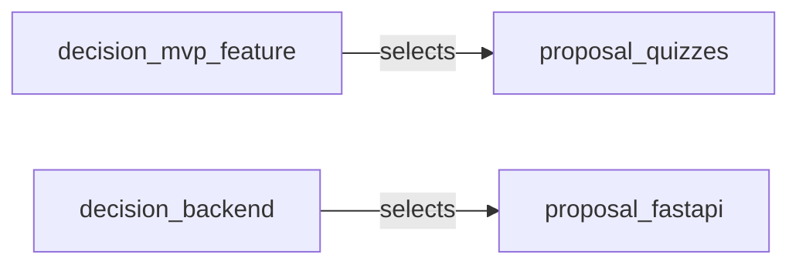

A relationship from `tech_fastapi` to a backend component is **conditional**: do not emit that Step 1 relationship or component unless it was actually discussed. The Step 2 planner may derive the backend component.

## 4.3 Expected Decision Graph

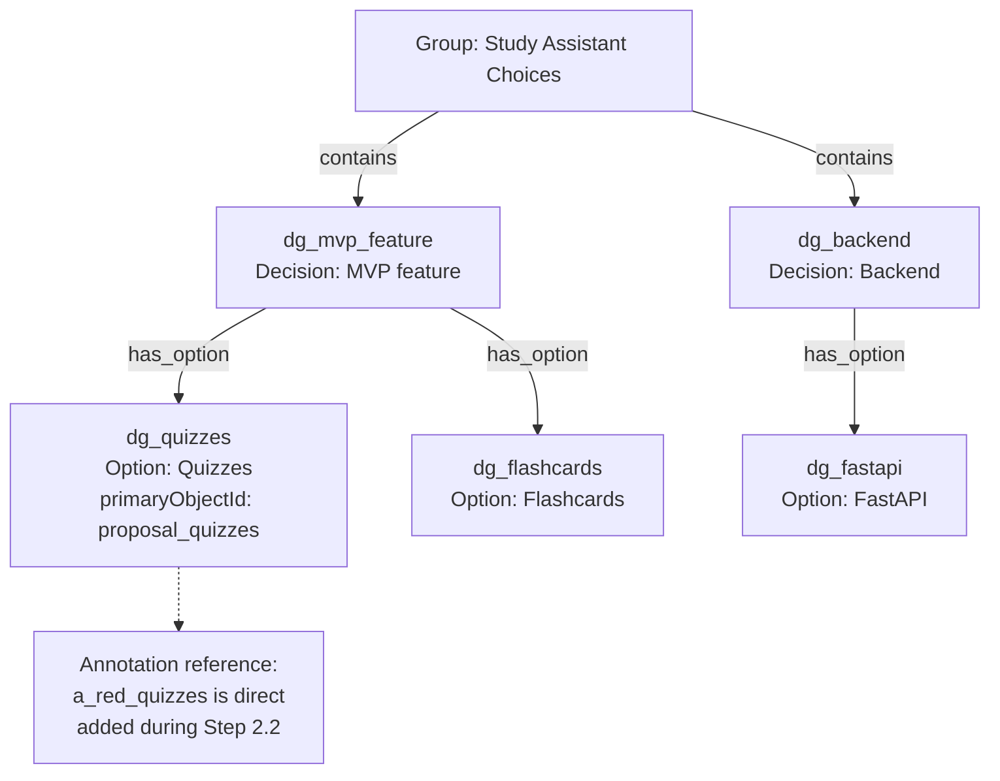

The `dg_quizzes` node starts with `annotations: []` and is enriched during Step 2.2 with `{ annotationId: a_red_quizzes, association: direct }`. Its `justifiedByObjectIds` may include `constraint_6w` only when supported. The graph may have a non-graph warning/reference for the unresolved account question; don't invent an accepted account decision. If accounts were substantively considered as a decision question, represent that decision as open.

## 4.4 Expected Implementation Graph

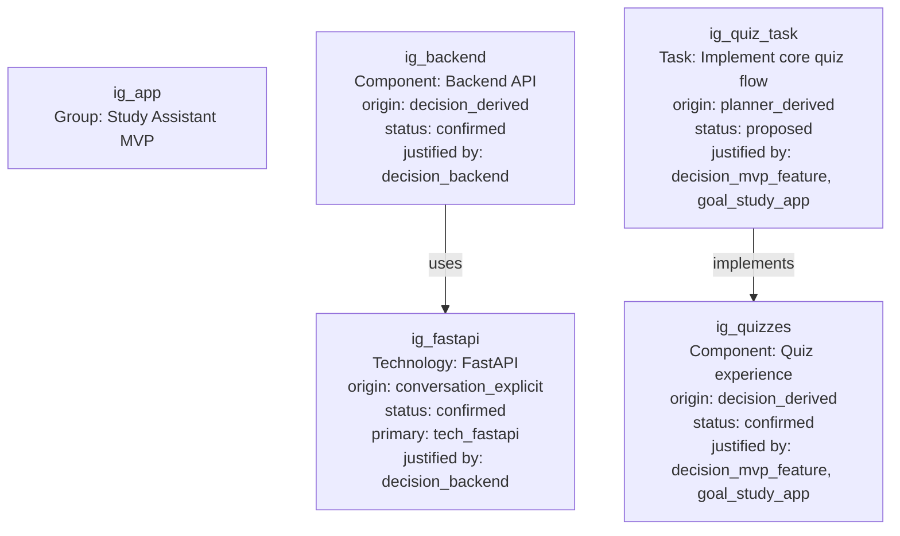

In this example, `ig_app` is a grouping node; no additional `contains` relationships are asserted unless generated by the builder. New nodes without Step 1 equivalents have no `primaryObjectId`. In an actual system, Step 2 should add enough detail to form a coherent implementation graph. Keep synthesized technical decisions `proposed` or `undecided` unless unavoidable consequences of accepted requirements; don't invent an authentication choice because accounts remain unresolved.

## 4.5 Expected links and annotations after Step 2.2

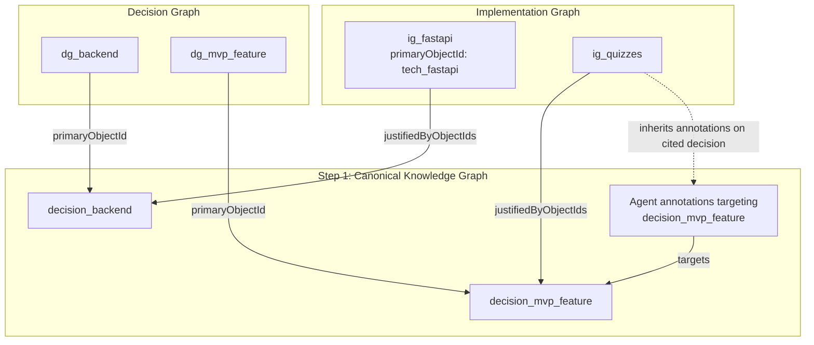

The cross-graph association between `dg_backend` and `ig_fastapi` has `kind: justification` and is derived through `decision_backend`; it is not a stored graph-node-to-graph-node foreign key. The `ig_quizzes` node does **not** automatically inherit opinions on the individual quiz or flashcard option objects unless it cites those objects explicitly. **Indirect relevance is not automatic endorsement or automatic inheritance**. The design intentionally favors accurate, explainable associations over showing every opinion everywhere.

---

# Part V — Implementation plan for Codex

## 5.1 Repository organization (adapt names to existing project)

The target runtime is **TypeScript**. Prefer the repository's existing TypeScript validation and testing tools; place module equivalents under its existing architecture. Do not introduce Python or a separate web application.

```text
final-orchestrator/
  contracts/
    conversation.schema
    knowledge-objects.schema
    annotations.schema
    knowledge-relationships.schema
    decision-graph.schema
    implementation-graph.schema
    planning-links.schema
    validation.schema
  step1/
    extract
    reconcile
    validate
    prompts/
      knowledge-extractor
  step2/
    build-decision-graph
    build-implementation-graph
    link-annotations
    link-cross-graph
    reconcile-graphs
    validate-graphs
    prompts/
      decision-builder
      implementation-builder
  common/
    stable-id-utilities
    provenance-utils
    indexing-utils
    llm-structured-output-adapter
  tests/
    fixtures/
    step1-extraction
    step1-reconciliation
    step1-validation
    step2-builders
    step2-linking
    step2-validation
    end-to-end
```

This is an organizational suggestion, not an instruction to overwrite the existing repository structure.

### Suggested TypeScript file/module layout

Use the existing repository layout where possible; the following is a **TypeScript-specific example**, not a demand to reorganize the application:

```text
src/
  orchestrator/
    finalOrchestrator.ts
    contracts/
      conversation.ts
      knowledge.ts
      annotations.ts
      relationships.ts
      decisionGraph.ts
      implementationGraph.ts
      planningLinks.ts
      validation.ts
    step1/
      extractKnowledge.ts
      reconcileKnowledge.ts
      validateKnowledge.ts
    step2/
      buildDecisionGraph.ts
      buildImplementationGraph.ts
      linkGraphs.ts
      validateGraphs.ts
    rendering/                    # Future Step 3 milestone
      layoutGraphs.ts
      renderExcalidraw.ts
      exportExcalidraw.ts
    common/
      ids.ts
      sourceRefs.ts
      llmStructuredOutput.ts
  tui/
    ...                           # Existing user experience; do not replace
```

**Ownership:** TypeScript runtime validators and linkers should not depend on a specific LLM provider. Any schemas represented in generic pseudocode elsewhere in this document should be translated into TypeScript `type`/`interface` declarations plus runtime validation in the repository's existing validation library.

## 5.2 MVP milestones (implementation order)

### Milestone A — Contract and fixture foundation

- Implement typed records/enums for **all Step 1 and Step 2 structures**, including nested types and all implementation-entity subtypes.
- Implement serialization/deserialization, schema versioning, strict required-field validation, and stable ID utilities.
- Add conversation fixtures: simple selection; switched selection; ambiguous reply; agent disagreement; no user commitment; mixed architecture/workflow discussion; non-software planning.
- Set a consistent policy for optional fields and missing values.

**Done when:** all fixtures parse and invalid data is rejected with useful errors.

### Milestone B — Step 1 extraction/reconciliation

- Write a schema-constrained LLM extraction adapter; isolate provider-specific APIs.
- Build a prompt that extracts knowledge objects, agent annotations, and knowledge relationships together.
- Build explicit reconciliation rules and stable candidate-to-canonical remapping.
- Preserve chronological revisions and user decision authority.
- Implement deterministic Step 1 structural validation.
- Produce `ConversationKnowledgeGraph` with warnings.

**Done when:** user decisions are not confused with agent proposals; duplicate questions and supersessions are handled on fixtures.

### Milestone C — Step 2 graph builders

- Implement Decision Graph builder against its restricted node/edge schema.
- Implement Implementation Graph builder against its broader planning schema.
- Each builder reads Step 1 only. They can be invoked in parallel.
- Builders emit correct canonical knowledge references and initially empty annotation lists.
- Ensure decision builder never invents user decisions; implementation builder labels planner additions.

**Done when:** builders produce well-formed graphs and demonstrate distinction between confirmed/derived/proposed content.

### Milestone D — Deterministic linking and reconciliation

- Index annotations by `targetObjectId`.
- Resolve per-node `direct`/`inherited` annotation references.
- Index Decision Graph nodes by `primaryObjectId`.
- Derive cross-graph links through Implementation Graph `primaryObjectId` and `justifiedByObjectIds`.
- Deduplicate graph nodes/edges as appropriate; remap IDs and re-link if needed.

**Done when:** selecting a graph node can retrieve its supporting decision(s) and correct agent annotations with no copied reasoning.

### Milestone E — Final validation and stable Step 3 handoff

- Enforce source/target node matrices, edge direction, no broken references, decision selection fidelity, plan provenance, and dependency cycle checks.
- Return `ValidatedPlanningGraphs` or a structured failure report.
- Save deterministic test snapshots of the serializable output.
- Define a read-only contract by which a future renderer can retrieve graph nodes, edges, annotations, labels and relevant statuses.

**Done when:** a graph consumer can build two views from the output without reopening the raw transcript.

## 5.3 Suggested orchestrator API (language agnostic)

```text
INTERFACE FinalOrchestrator {
  extractConversation(input: ConversationInput): Step1Result
  buildPlanningGraphs(knowledgeGraph: ConversationKnowledgeGraph): Step2Result
  processConversation(input: ConversationInput): FinalOrchestratorResult
}

RECORD FinalOrchestratorResult {
  knowledgeGraph?: ConversationKnowledgeGraph
  planningGraphs?: ValidatedPlanningGraphs
  step1Report: ValidationReport
  step2Report?: ValidationReport
}

FUNCTION processConversation(input):
  preliminary = extractKnowledgeObjectsAnnotationsAndRelationships(input)
  reconciled = reconcile(preliminary, input.messages)
  step1 = validateKnowledgeGraph(reconciled, input)
  IF step1.failed:
    RETURN reportStep1Failure(step1)

  dg, ig = buildBothGraphs(step1.knowledgeGraph)
  step2 = finalizePlanningGraphs(step1.knowledgeGraph, dg, ig)
  IF step2.failed:
    RETURN reportStep2Failure(step1.knowledgeGraph, step2)

  RETURN FinalOrchestratorResult(
    knowledgeGraph = step1.knowledgeGraph,
    planningGraphs = step2.planningGraphs,
    step1Report = step1.report,
    step2Report = step2.report
  )
```

The interface is illustrative; choose synchronous, asynchronous, queue, or streaming integration to match the actual application. The key is that the knowledge and graph contracts should not depend on LLM-vendor SDK objects.

## 5.4 Test plan and evaluation criteria

### Step 1 golden tests

| Scenario | Expected behavior |
|---|---|
| Explicit user picks FastAPI | Resolved Decision; proper Proposal; supporting user message |
| Agent recommends Django; user silent | Proposal and annotation; Decision stays open |
| User first picks Django then changes to FastAPI | ONE active decision, FastAPI selected, earlier choice in history |
| User says “I agree” during interleaved topics | Do not assert acceptance without identifiable referent |
| Blue changes position | Two correctly sequenced annotations, or a current/revised chain |
| Agent says “low risk” | Preserve expressed assessment; do not fabricate numeric risk score |
| Requirements and implementation components described but not debated | Extract them without inventing formal decisions |
| Same component discussed under synonyms | Canonicalize if reliably identical; preserve multiple source refs |
| "No authentication for MVP" | Preserve negative scope; planner must not auto-confirm authentication |
| A nonsoftware idea | Extract goals/tasks/workflows without forcing a database/backend ontology |

### Step 2 graph and linking tests

| Scenario | Expected behavior |
|---|---|
| Decision with two alternatives | One decision node, two option nodes, valid `has_option` edges |
| Decision without accepted alternative | No invented selected state |
| Planner generates required implementation task | `primaryObjectId` absent, `origin = planner_derived`, meaningful justifications |
| Implementation node cites decision | Cross-link generated to matching Decision Graph node |
| Implementation node cites only a requirement | No artificial Decision Graph link |
| Annotation targets component directly | Implementation node receives `direct` annotation ref |
| Annotation targets a decision used as justification | Implementation node receives `inherited` ref with `viaObjectIds` |
| Both paths find same annotation | Deduplicate, prefer `direct` |
| Disconnected important nodes | Flag only if a plan consistency rule requires connection; not all nodes need edges |
| `depends_on` cycle among implementation tasks | Validator reports dependency cycle |
| `has_option` from group to option | Validator rejects endpoint mismatch |
| Rejected proposal labeled as confirmed technology | Validator flags contradiction |
| Graph rebuilt with different node IDs | Cross-links recomputed using unchanged canonical knowledge IDs |

### Quality metrics for the *engineering evaluation*, not graph objects

The decision to remove **agent metrics from the knowledge schema** does not prevent measuring the orchestrator itself. Track test-set extraction precision/recall, decision-state accuracy, annotation attribution accuracy, source-grounding accuracy, schema validity, broken-reference rate, link correctness, and latency/cost. These are **system observability/evaluation metrics**, not part of the user's plan graph.

## 5.5 Failure modes and mitigations

1. **Fabricated consensus:** LLM assumes four agents agree. → Require source-backed annotations and explicit user authority.
2. **Duplicate or changing decisions:** Repeated topics create contradictory outcomes. → Canonical decision identity + chronological history + reconciliation.
3. **Over-inherited notes:** Broad justifications attach every comment to everything. → No multi-hop inheritance; avoid annotations on pure groups; prefer specific references.
4. **Hallucinated architecture:** Planner silently invents technology selections. → Mark derived/suggested origin, enforce unresolved decisions, audit constraints.
5. **Meaningless graph edges:** LLM connects nodes because they are topically related. → Typed endpoint matrices, provenance and structural validation.
6. **Unstable cross-links after redrawing:** Graph-node IDs change. → Cross-links derived from canonical knowledge IDs, recompute index.
7. **Long transcript truncation:** Later user corrections missed. → Snapshot/version checks; chunk + global chronological reconciliation only when needed.
8. **Incorrect speaker/source references:** Attribution errors create false reasoning. → Validate `SourceRef` against original speaker-tagged messages.
9. **Output explosion:** Hundreds of tiny objects/annotations clutter visual plan. → Canonicalize object granularity and retain a rich graph; let future renderer summarize selectively.
10. **Overengineering:** Too many LLM stages, scores and extra metadata. → MVP is one extraction/reconciliation call, two graph builds, deterministic linking, deterministic validation.

---

# Part VI — Handoff to future Step 3 (intentionally minimal)

### Mermaid: minimal TUI-to-Excalidraw file handoff

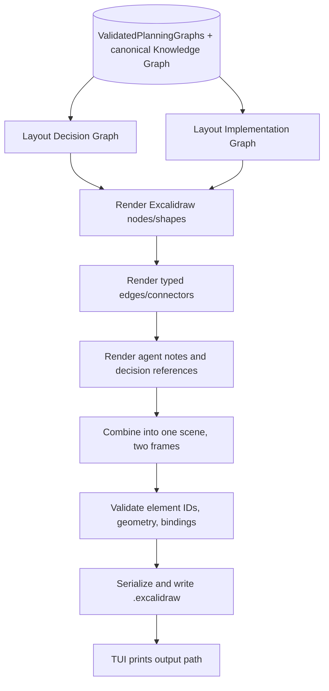

This defines the future output boundary only. Excalidraw layout details and serialization still require a separate Step 3 implementation milestone.

The renderer will eventually use the **validated** Planning Graphs and the canonical Knowledge Graph to produce an editable `.excalidraw` scene. Rendering is a separate concern and should not reinterpret the conversation.

*The Mermaid diagram above is the complete minimal rendering/export handoff; detailed Step 3 implementation remains deferred.*

Expected visualization:

- **Decision frame/view:** hierarchy of decision questions with selected/deferred/not-selected options and traceable agent annotations.
- **Implementation frame/view:** architecture, workflows, tasks and dependencies; planner-derived elements distinguishable from confirmed ones.
- **Traceability:** small decision references on implementation elements, with the underlying cross-graph index usable for navigation in a custom app.
- **Agent colors:** Red, Yellow, Green, Blue can render as consistent colored note markers. No mandatory note for agents who never commented.
- **No direct coupling to drawing IDs:** Graph node IDs are logical; the renderer may generate entirely different Excalidraw element IDs.

**For the current Step 1–2 work, defer** pixel layout, frame sizes, arrow routing, text measurement, node positioning, note-collapsing rules, and Excalidraw serialization details. These are mandatory considerations when implementing the eventual TUI-to-file renderer; custom interactive editing is not required. The Step 2 data contracts should be stable before those decisions.

---

# Part VII — Instructions to Codex (copy/paste implementation brief)

> Implement the final-orchestrator MVP described in this README in the **existing TypeScript project**. Do not rewrite the app, change the multi-agent debate engine, or introduce Python. Treat the pseudocode as language-agnostic schema and behavior contracts. First inspect the repository and identify the existing message model, LLM client, persistence patterns, validation tools and test framework. Reuse them where possible.
>
> Implement **Step 1** (`Extract` objects + annotations + relationships; `Reconcile`; `Validate`) producing `ConversationKnowledgeGraph`, and **Step 2** (independent Decision/Implementation graph builders; deterministic cross-graph/annotation linking; graph reconciliation and validation) producing `ValidatedPlanningGraphs`. Encode every domain type, enum, object subtype, graph node/edge subtype, source reference, cross-link, and validation report from this README.
>
> Keep the canonical Knowledge Graph as the single source of truth. Graph builders must use Knowledge Object IDs; leave annotation refs empty until the deterministic linker populates them. Do not add an agent scoring/metrics subsystem. Do not invent user decisions or agent reasoning. Keep proposed versus accepted decisions and planner-generated versus conversation-established implementation content clearly separated. Implement test fixtures and validation rules before any Excalidraw rendering work.
>
> Work in small, testable milestones. Before touching code, summarize the proposed modules, the repository integration points and which files will change. Implement contracts and unit tests first; then extraction/reconciliation; then independent builders; then linking; then graph validation/end-to-end fixtures. Run the existing project's lint/typecheck/tests and report any limitations or unresolved design ambiguities instead of silently guessing.

### End-to-end completion gate (outside current Step 1–2 coding milestones)

The complete TUI feature is considered finished **only when** invoking finalization writes a valid `.excalidraw` document to disk and the TUI reports the file path. The file must open in Excalidraw and contain both diagrams, meaningful internal graph edges, agent annotation notes, and readable status/provenance cues. No browser UI is needed. An intermediate `ValidatedPlanningGraphs` JSON response alone does **not** satisfy this product acceptance condition.

## Final acceptance checklist

- [ ] Minimal ordered messages (`id`, `sequence`, `speaker`, `content`) are sufficient input.
- [ ] All Step 1 object kinds and all six implementation entity subtypes are represented in schemas.
- [ ] Decisions distinguish current resolution, options, proposal dispositions, authority and meaningful history.
- [ ] Agent annotations are canonical records targeting objects; no fabricated agent viewpoints.
- [ ] Knowledge relationships link object IDs, not graph node IDs.
- [ ] Step 1 reconciliation handles duplicates, changed choices and ID redirects.
- [ ] Step 1 validator checks sources, referential integrity, authority, status and annotation attribution.
- [ ] Decision Graph has `group/decision/option` nodes and typed internal edges.
- [ ] Implementation Graph has `group/component/technology/workflow/task/interface/data_entity/milestone` nodes and typed internal edges.
- [ ] Each graph node has `primaryObjectId?`, `justifiedByObjectIds[]`, and `annotations[]` inherited from the base schema.
- [ ] Builders leave annotation refs empty; linking resolves `direct` versus `inherited` once.
- [ ] Cross-graph links are derived deterministically using shared Knowledge Object IDs, without direct graph-builder dependencies.
- [ ] Reconciliation/validation follows linkage, with safe re-linking after repairs.
- [ ] Planner-generated objects/edges are distinguished from conversation-established facts and choices.
- [ ] Test fixtures cover revisions, ambiguous language, unresolved decisions, attribution, graph errors and cross-link correctness.
- [ ] Validated graph output can be consumed by a future Excalidraw renderer without raw-transcript re-analysis.
- [ ] For this Step 1–2 milestone, Step 3 implementation remains deferred; **end-to-end TUI completion additionally requires** a real editable `.excalidraw` export.

---

**Design baseline:** `Structured conversation → Step 1 [Extract → Reconcile → Validate] → Canonical Knowledge Graph → Step 2 [Build Decision Graph & Implementation Graph independently → Link → Reconcile & Validate] → Validated Planning Graphs → Step 3 renderer/export → editable `.excalidraw` artifact (required end-to-end; later milestone in this spec)`.
