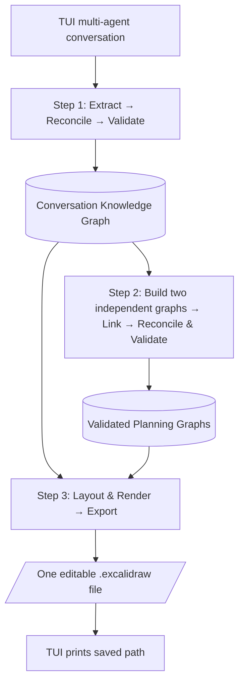
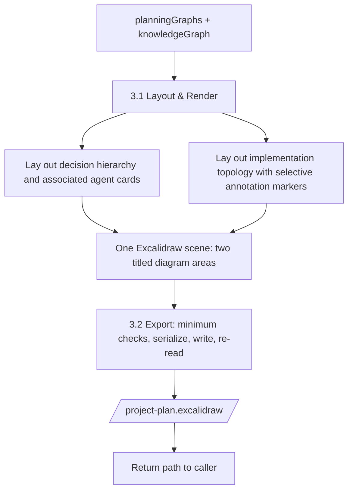
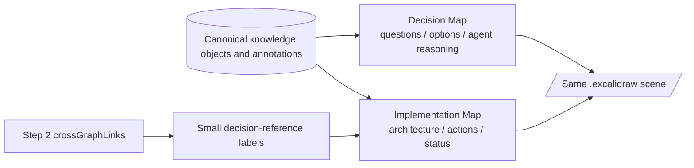
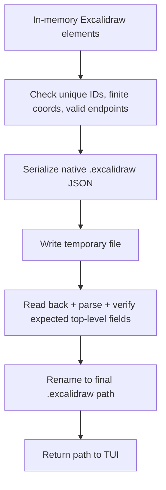

# Step 3 — Excalidraw Generation (TypeScript TUI)

> **Implementation specification for Codex.** This document describes **only Step 3** of the final orchestrator. It is grounded in two real example payloads: `Pasted text(8).txt` (Step 2 output) and `Pasted text(10).txt` (Step 1 knowledge output; `Pasted text(9).txt` contains the same knowledge payload). Treat these files as **test fixtures**, not as a request to redesign Steps 1 or 2.
>
> **Final deliverable:** One editable `.excalidraw` file written to disk; print its absolute or relative path in the existing terminal UI (TUI). **No web UI, browser editor, React page, LLM drawing agent, PNG-only output, or extra planning pass.**

## 0. Goal and boundaries

The user and four color agents debate an idea. Prior pipeline stages have already extracted a canonical knowledge graph and synthesized validated decision and implementation graphs. Step 3 **visualizes** those results; it never decides which technologies to adopt, revises any decision, invents agent opinions, or changes graph topology.

**Agreed three-stage overall architecture:**



**Step 3, intentionally simplified:**



`Layout & Render` can be one public TypeScript function with small helpers. `Export` is the second public function. Do **not** reinstate separate LLM interpretation, elaborate layout-scene persistence, visual QA services, collision-repair loops, multiple semantic validators, or annotation re-summarization.

### Non-goals

- Implementing Steps 1 or 2, changing their schemas, or adding metadata to debate messages.
- Building an interactive application, embedding Excalidraw, drawing live as agents speak.
- Synchronizing an Excalidraw file back into the knowledge graph after user edits.
- Automatically creating new tasks/decisions or resolving open questions.
- Drawing physical cross-canvas arrows between decision and implementation graphs.

## 1. Real input contract: important observations

The supplied Step 2 output is **not** a bare `PlanningGraphs`. It is an envelope:

```ts
interface Step2Envelope {
  planningGraphs: PlanningGraphs;
  validationReport: {
    passed: boolean;
    issues: unknown[];
  };
}
```

The supplied Step 1 knowledge output is likewise an envelope:

```ts
interface Step1Envelope {
  knowledgeGraph: ConversationKnowledgeGraph;
  objectRedirects: Array<unknown>;
}
```

The renderer can accept either two envelopes or their unwrapped contents; normalize **once at the entry point**. Do not expect raw conversation messages. The actual examples share:

- `conversationId = "conversation-23c93077d648565a"`
- Step 1 `snapshotSequence = 13`
- Step 2 `knowledgeSnapshotSequence = 13`
- Step 2 `validationReport.passed = true`, `issues = []`
- **Decision graph:** 11 nodes, 10 edges
- **Implementation graph:** 16 nodes, 22 edges
- **Cross-graph:** 18 entries (also two denormalized lookup indexes)
- **Knowledge graph:** 24 objects, 14 annotations, 11 relationships
- Approximately 35 annotation references across the two graphs (some repeat by design)

Use these counts in the sample-fixture test. Future conversations may have different counts, types and sizes. **Never hard-code book-swap project labels into the renderer.**

### 1.1 Exact TypeScript-oriented pseudotypes

These contracts describe the fields consumed by Step 3, not an exhaustive replacement for your production Zod/TypeScript schemas. **Reuse the existing types in the repository where possible.** Property names below follow the real payloads (camelCase).

```ts
type Agent = "red" | "yellow" | "green" | "blue";
type AnnotationAssociation = "direct" | "inherited";

type NodeAnnotationRef = {
  annotationId: string;
  association: AnnotationAssociation;
  // IMPORTANT: actual sample uses an ARRAY, not singular viaObjectId!
  viaObjectIds: string[];
};

type SharedGraphNode = {
  id: string;
  title: string;
  description: string;
  nodeType: string;
  primaryObjectId?: string; // omitted for derived/group nodes
  justifiedByObjectIds: string[];
  annotations: NodeAnnotationRef[];
};

type DecisionNode = SharedGraphNode & {
  nodeType: "group" | "decision" | "option";
};

type ImplementationNode = SharedGraphNode & {
  nodeType:
    | "group" | "component" | "technology" | "workflow"
    | "task" | "interface" | "data_entity" | "milestone";
  origin: "conversation_explicit" | "decision_derived" | "planner_derived" | "planner_suggested";
  status: "confirmed" | "proposed" | "undecided" | "deferred";
};

type SharedGraphEdge = {
  id: string;
  sourceNodeId: string; // NOT sourceId
  targetNodeId: string; // NOT targetId
  relation: string;
  origin: "conversation_explicit" | "knowledge_derived" | "planner_derived";
  primaryRelationshipId?: string;
  justifiedByObjectIds: string[];
  description?: string;
};

type DecisionEdge = SharedGraphEdge & {
  relation: "contains" | "has_option" | "depends_on" | "influences";
};

type ImplementationEdge = SharedGraphEdge & {
  relation:
    | "contains" | "uses" | "communicates_with" | "depends_on"
    | "implements" | "precedes" | "produces";
};

type Graph<N, E> = { nodes: N[]; edges: E[] };

type CrossGraphLink = {
  decisionNodeId: string;
  implementationNodeId: string;
  viaKnowledgeObjectId: string;
  kind: "justification" | "primary_shared_object";
};

type PlanningGraphs = {
  schemaVersion: string;
  conversationId: string;
  knowledgeSnapshotSequence: number;
  decisionGraph: Graph<DecisionNode, DecisionEdge>;
  implementationGraph: Graph<ImplementationNode, ImplementationEdge>;
  crossGraphLinks: {
    links: CrossGraphLink[];
    byDecisionNodeId: Record<string, CrossGraphLink[]>;
    byImplementationNodeId: Record<string, CrossGraphLink[]>;
  };
  warnings: unknown[];
};

type KnowledgeObject = {
  id: string;
  kind: string; // see sample kind = decision, proposal, requirement, ...
  title: string;
  description: string;
  state?: string;
  origin: string;
  selectedProposalId?: string | null;
  options?: Array<{ proposalId: string; disposition: string }>;
  sourceRefs?: Array<{ messageId: string; excerpt?: string }>;
  [extra: string]: unknown; // typed unions already in Step 1 are preferred
};

type AgentAnnotation = {
  id: string;
  agent: Agent;
  targetObjectId: string;
  stance: string; // e.g. support, concern, question, conditional, neutral
  reasoning: string;
  conditions: string[];
  state: "current" | "revised" | string;
  revisesAnnotationId: string | null;
  sourceRefs: Array<{ messageId: string; excerpt?: string }>;
};

type ConversationKnowledgeGraph = {
  schemaVersion: string;
  conversationId: string;
  snapshotSequence: number;
  objects: KnowledgeObject[];
  annotations: AgentAnnotation[];
  relationships: Array<{
    id: string;
    sourceObjectId: string;
    targetObjectId: string;
    relation: string;
  }>;
  warnings: unknown[];
};
```

**Do not mistake proposal state for option selection.** In the sample `proposal-local-browser-ui.state = "active"` while the parent decision's corresponding option disposition is `"not_selected"`. For option badges, consult the **parent Decision object's `options[].disposition`**, not `proposal.state`. Likewise `decision-storage` resolved to SQLite after CSV was earlier selected; Red's original CSV annotation is `"revised"` and his newer SQLite annotation is `"current"`.

**Do not mistake `implementationGraph.status` for a feature approval decision.** It is a planning status. Deferred and undecided nodes must be visibly differentiated and must not be presented as part of the confirmed MVP.

**Do not assume one annotation per agent**: `option-sqlite-storage` has multiple Blue annotations. Preserve all annotations, with compact summaries in the main diagram and source-based detail text where needed. No fabricated opinion from missing agents.

### 1.2 Inputs to main function

```ts
type GenerateExcalidrawInput = {
  planningGraphs: PlanningGraphs;
  knowledgeGraph: ConversationKnowledgeGraph;
  outputPath: string;
};

type GenerateExcalidrawResult = {
  filePath: string;
  elementCount: number;
  warnings: string[];
};

async function generateExcalidraw(input: GenerateExcalidrawInput):
  Promise<GenerateExcalidrawResult> {
  const scene = await buildExcalidrawScene(input.planningGraphs, input.knowledgeGraph);
  return exportExcalidraw(scene, input.outputPath);
}
```

Before drawing, check `conversationId` matches and `knowledgeSnapshotSequence === snapshotSequence`; if not, **fail with a clear diagnostic** rather than mixing two sessions. If the existing TUI has a meaningful way to display Step 2's validation failures, honor that before calling Step 3.

## 2. Layout & Render: how to draw the final two maps

### 2.1 Visual contract

Generate **one canvas with two clearly labeled regions**:

1. **Decision Map** — a hierarchical decision tree / DAG view showing decision questions, accepted and rejected/deferred options, direct colored agent comments, and whether a choice remains unresolved. A generated group node is only an organizer.
2. **Implementation Map** — the planned architecture/workflow/roadmap showing components, technology, tasks, data entities, milestones, implementation statuses, and typed connectors. Direct agent comments may be shown as cards; inherited commentary stays compact and traceable to the originating decision/proposal.

Do not connect regions with dozens of long arrows. Place **short decision references** beside implementation nodes using `crossGraphLinks.links` (e.g., `D2 · SQLite storage`). The maps remain logically independent; the knowledge objects are the common source of truth.



#### Styles (centralized configuration, not hidden heuristics)

Use a consistent light theme and adequate contrast. Suggested defaults:

| Semantic display | Recommended treatment |
|---|---|
| Decision / group | Purple accent, decision title + state |
| Implementation component | Blue accent |
| Technology | Green accent |
| Workflow / task | Neutral or subtle blue, distinguish by labels |
| Data entity / interface | Neutral accent, type label |
| Accepted/confirmed | Green badge/border |
| Not selected/rejected | Muted red badge/border |
| Deferred | Amber/dashed |
| Undecided/open | Amber outline + explicit `UNDECIDED` |
| Planner-derived | Small `Derived` marker, not equivalent to user-approved |
| Red/Yellow/Green/Blue annotation | Respectively red/yellow/green/blue accent on editable text card |

Color **alone** cannot convey meaning; include a visible text label (status/agent/association). Keep main diagram legible at a reasonable zoom. Both regions should have a header, legend (abbreviated), and visual separation. A named native frame is optional; if frame generation complicates compatibility, use ordinary labeled background containers.

### 2.2 Decision node display content

Read canonical status from the **knowledge objects**. Decision node `decision-storage` -> object `decision-storage` has `state = "resolved"`, `selectedProposalId = "proposal-sqlite-storage"`. For its option nodes:

- `option-sqlite-storage` (`primaryObjectId = proposal-sqlite-storage`) -> **Selected**.
- `option-csv-storage` (`primaryObjectId = proposal-csv-storage`) -> **Not selected / superseded**.
- `decision-barcode-scanning` -> **Deferred**; its barcode option is deferred, not an approved feature.
- `decision-backup-command` -> selected backup command, but **backup destination remains undecided** in the implementation view.

Resolve option status by building `Map<proposalId, disposition>` from each parent decision object. Scope this mapping by parent decision where necessary: proposal disposition is contextual, not necessarily global.

Keep all candidate options attached to their decision, not in a generic unrelated list. Retain direct annotations on decision or option nodes as provided.

**Decision tree vs. DAG:** use `contains` (`group → decision`) and `has_option` (`decision → option`) to determine main layout. Route `depends_on` and `influences` as secondary edges if present. Do not invent missing hierarchy links.

### 2.3 Implementation node display content

Draw confirmed core elements prominently; draw proposed, deferred, and undecided nodes with explicit statuses. Important sample scenarios:

- `impl-terminal-app` — confirmed user-selected interface.
- `impl-data-storage-component` and `impl-sqlite` — confirmed local SQLite storage.
- `impl-book-swap-workflow` — workflow node; its graph status is `proposed` (even though the knowledge workflow has `adoptionState: confirmed`): **do not silently overwrite Step 2 status**; note inconsistencies as warnings rather than revising semantics.
- `impl-book-record` and `impl-reservation-record` — data nodes.
- `impl-backup-location` — `undecided`, not a chosen storage provider.
- `impl-retention-policy` — `undecided`; don't draw a completed deletion rule.
- `impl-barcode-deferred` — `deferred`; not part of current MVP execution.
- `impl-donation-task`, `impl-list-task`, `impl-reserve-task`, `impl-title-search-task` — generated/proposed tasks, not user-confirmed completion.

**MVP correctness rule:** `deferred` nodes can remain in the diagram, but must visually appear in a separate `Later / Deferred` lane or have a clearly unmistakable deferred treatment. `undecided` details belong in a `Needs decision` lane/callout rather than masquerading as finished architecture.

### 2.4 Annotation resolution and rendering

No new inference or LLM summarization. Resolve the existing Step 2 annotation references to Step 1 records using a lookup by `annotationId`. The sample uses:

```ts
{
  annotationId: "ann-blue-sqlite-conditional-test",
  association: "inherited",
  viaObjectIds: ["proposal-sqlite-storage"]
}
```

`viaObjectIds` is an **array**. For direct references it is `[]`. For inherited ones display a short originating-object label when useful (e.g., `via SQLite option` or its corresponding `D#`). Be faithful to `annotation.state` and `revisesAnnotationId`.

**Recommended minimal policy**:

- Decision node or option node: show **direct** agent notes next to/below node. For many notes, lay out cards in a compact vertical list or two columns, preserving every note's actual text either in the card or in a numbered detail column nearby.
- Implementation node: show **direct** annotations as visible notes, but render **inherited** comments mainly as colored agent markers plus a short reference (e.g., `Blue · via SQLite option`). Do not imply an inherited comment directly endorsed the entire implementation node.
- Avoid a repeated wall of the same reasoning on many implementation nodes. Deduplicate **within one target node by annotation ID**, not globally across nodes; multiple nodes can legitimately refer to the same annotation.
- Use annotation `state = revised` visibly (`previous view`, or similar), especially `ann-red-csv-support`. Show updated Red SQLite support as current. Preserve the old opinion for decision history, not as current endorsement.
- Show `stance` exactly enough to distinguish `support`, `concern`, `question`, `conditional`, `neutral`; avoid coercing them all to `supports`.
- Do not create blank four-agent slots when an agent was silent.
- Each agent note has a source `messageId`; optional small `m11` / `A#` tags provide traceability.
- Preserve `conditions` when material. E.g., Blue's SQLite endorsement depends on testing against double booking.

A shared annotation object must never be mutated when drawing, and a truncated display must not silently erase substantive text. For MVP keep short complete reasonings when possible; for longer notes, put the complete text in a nearby plain-text detail area **inside the same `.excalidraw` canvas** (not in TUI hover UI). The initial example has manageable text lengths.

### 2.5 Edge and layout rules

The underlying implementation graph is **not necessarily a tree**: it includes `contains`, `uses`, `implements`, `produces`, `precedes`. Treating all 22 sample edges as a single parent-child tree would make an unreadable or cyclic hierarchy.

**Layout hierarchy:**

- Decision graph: lay out primary `contains` and `has_option` edges top-to-bottom; secondary decision relations as dashed routed overlays.
- Implementation graph: use `contains` as a primary grouping/hierarchy signal; use `precedes` to order workflow tasks; position remaining links (`uses`, `implements`, `produces`, `communicates_with`, `depends_on`) as separately styled labeled connectors. A left-to-right layered layout is a reasonable starting point.
- The sample has `impl-group-mvp` with eight `contains` edges and a three-task sequence `donation → list → reserve`; this is a useful smoke test for hierarchy plus process order.
- Preserve edge direction: `precedes(A, B)` points A → B, while `depends_on(A, B)` means A depends on B. Don't invert dependency semantics to fit an arrow style.
- Distinguish `uses`, `produces`, and `implements` with connector styles/labels. Some semantic relations between the same node pair are intentional (e.g., workflow `uses` and `produces` book record): don't accidentally drop one due to pair-level deduplication.
- If a hierarchy node has more than one potential parent, choose one **layout parent** but retain the other relationships as secondary links; do not mutate the planning graph.

**Text-aware sizing:** A node should have enough height for its title/status, and attached annotation cards need space. Use reasonable node widths (e.g., 220–260 px), card widths (200–240 px), word wrap, and configurable spacing. Measure (or reasonably estimate) card height **before** calling the layout engine. You do not need an independent persistent `LayoutScene` schema; keep positioned results in local variables.

**Engine:** `elkjs` is a good default in a headless TypeScript/Node TUI. Layout both graphs separately and translate the second one to the right of the first with a generous gap. Alternatively choose a simpler deterministic layout if ELK cannot be integrated reliably; never ask the LLM for coordinates.

```ts
async function buildExcalidrawScene(
  graphs: PlanningGraphs,
  knowledge: ConversationKnowledgeGraph
): Promise<ExcalidrawScene> {
  const objectById = indexById(knowledge.objects);
  const annotationById = indexById(knowledge.annotations);

  const decisionDisplay = buildDecisionDisplay(graphs.decisionGraph, objectById, annotationById);
  const implementationDisplay = buildImplementationDisplay(
    graphs.implementationGraph, objectById, annotationById,
    graphs.crossGraphLinks.links
  );

  // Hierarchy/edge routing use different defaults for each graph.
  const [decisionLayout, implementationLayout] = await Promise.all([
    layoutDecisionGraph(decisionDisplay),
    layoutImplementationGraph(implementationDisplay)
  ]);

  const decisionElements = renderGraph(decisionLayout, "decision");
  const implementationElements = renderGraph(implementationLayout, "implementation");
  return composeTwoDiagramScene(decisionElements, implementationElements);
}
```

**All helpers above are architectural pseudocode**, not a claim that those exact functions already exist.

### 2.6 Render editable native Excalidraw elements

The resulting file must contain **native editable text, shapes and arrows**, not an image of the map. Create a primary shape for each graph node, separate editable label text, editable colored note shapes/text, and Excalidraw arrows for graph edges. Preserve element mappings locally so arrow endpoints bind to the right node shapes.

An Excalidraw element requires more metadata than `type`, `x`, `y`, `width`, `height`: styling, version fields, seeds, point geometry for arrows, and optionally bindings/frame memberships. Use **one version-pinned serializer adapter** and a known-good fixture rather than manually inventing arbitrary partial element objects.

For TypeScript TUI specifically, **headless compatibility is the deciding factor**:

- First try the official `@excalidraw/excalidraw` skeleton conversion helpers in a tiny Node runtime smoke test.
- If those helpers drag in browser-only globals or DOM dependencies, do not introduce a React frontend just to save the file. Implement a tested headless JSON element adapter (or use a compatible standalone utility), using a valid Excalidraw fixture as ground truth.
- Use `elkjs` to position shapes irrespective of which serializer is chosen.
- Native frames are optional for MVP. Labeled scene regions are sufficient if frame bindings add fragility.
- Keep stable mapping `{ graphNodeId → Excalidraw primary shape ID }` and `{ graphEdgeId → Excalidraw arrow ID }` for the current file. Exact same IDs across multiple exports are nice but not a blocker.
- Use cross-graph links as readable IDs/labels rather than drawing many cross-region connectors.

**Avoid a misleading claim of portability:** Text on the canvas is editable; custom `customData` metadata may be convenient but is not a substitute for visible decision IDs and agent reasoning in the exported file.

## 3. Export: minimal and reliable

`exportExcalidraw` performs only low-cost hard checks, serialization, write, and verification.



Use the standard scene-document wrapper appropriate for the serializer's pinned format. A typical file skeleton is:

```json
{
  "type": "excalidraw",
  "version": 2,
  "source": "https://excalidraw.com",
  "elements": [],
  "appState": { "viewBackgroundColor": "#ffffff" },
  "files": {}
}
```

This skeleton is **not sufficient alone**: `elements` must contain full Excalidraw-compatible element records. A successful `JSON.stringify` does not prove Excalidraw will accept the scene.

```ts
type ExcalidrawScene = {
  elements: unknown[]; // replace with tested/pinned Excalidraw element type
  appState: Record<string, unknown>;
  files: Record<string, unknown>;
};

type ExportResult = {
  filePath: string;
  elementCount: number;
  warnings: string[];
};

async function exportExcalidraw(
  scene: ExcalidrawScene,
  outputPath: string
): Promise<ExportResult> {
  assertUniqueIds(scene.elements);
  assertFiniteCoordinates(scene.elements);
  assertBindingsReferToExistingShapes(scene.elements);
  assertContainsBothDiagramRegions(scene.elements);

  const json = serializeVersionPinnedExcalidrawDocument(scene);
  const finalPath = resolveSafeOutputPath(outputPath);
  const temporaryPath = temporaryFileInSameDirectory(finalPath);

  await ensureDirectoryExists(parentDirectory(finalPath));
  await writeUtf8(temporaryPath, json);
  const parsed = JSON.parse(await readUtf8(temporaryPath));
  assertExcalidrawTopLevelStructure(parsed);
  await atomicOrSafeFinalize(temporaryPath, finalPath);

  return { filePath: finalPath, elementCount: scene.elements.length, warnings: [] };
}
```

Do not silently overwrite an existing file unless the caller opted into it; a unique filename derived from project + conversation ID is fine. Errors should propagate to the TUI; report success **only after** write/readback passes. The TUI needs a saved path, not the JSON echoed into the terminal.

### Validation budget — deliberately small

**Required:** one scene check for element IDs, finite geometry, valid connectors; a file write/readback; one real Excalidraw import smoke test (as a fixture/integration test, not necessarily on every CLI invocation).

**Defer:** pixel-perfect overlap analysis, recursive layout retries, multi-pass semantic validation, browser screenshot testing on every export, user-interactive annotation panels, animation.

## 4. Cross-graph linking — what to show and how

Step 2 already generated cross-graph links. **Do not recompute their meaning with an LLM.** Read `planningGraphs.crossGraphLinks.links`. `byDecisionNodeId` and `byImplementationNodeId` are optimization indexes, not independent sources of truth.

Use a display helper to collect decision references for each implementation node:

```ts
function decisionReferencesForImplementationNode(
  nodeId: string,
  links: CrossGraphLink[],
  decisionNodesById: Map<string, DecisionNode>
): Array<{ decisionNodeId: string; title: string; kinds: string[] }> {
  // Group by decisionNodeId, combine kinds from duplicate pair matches.
  // Label by node title; prefer compact IDs in the diagram.
  // Do not draw physical cross-map arrows.
}
```

**Sample duplicate-link case:** `decision-barcode-scanning ↔ impl-barcode-deferred` appears as both `justification` and `primary_shared_object`. Likewise the terminal and backup options each have two link kinds to the same implementation node. **One UI reference per decision/implementation pair**, optionally tagged with both kinds, avoids repeating badges.

Sample references expected:

- `impl-terminal-app` → `decision-interface`, `option-terminal-app`.
- `impl-sqlite` → `decision-storage`, `option-sqlite-storage`.
- `impl-backup-command` → `decision-backup-command`, `option-backup-command`.
- `impl-barcode-deferred` → `decision-barcode-scanning`, `option-barcode-scanning`.

Decision references should not themselves imply endorsement: e.g. a rejected option linked as an alternative remains rejected. To avoid clutter, prefer a reference to the **parent decision question** as the main badge and show relevant option only if useful; an additional detail legend can preserve the complete link index.

## 5. Integration points and proposed files

Fit into the current repository structure rather than forcing an overhaul. A minimal module design:

```text
src/
  orchestrator/
    rendering/
      buildExcalidrawScene.ts    # Layout + rendering; one main public function
      exportExcalidraw.ts        # Validate minimal scene + serialize + write
      excalidrawAdapter.ts       # Pinned headless-compatible element creation
      renderingTypes.ts          # Local display/style types (keep thin)
      renderingConfig.ts         # Colors, sizes, spacing, font styles
  tui/
    ...                          # Existing terminal conversation flow

tests/
  fixtures/
    step1-knowledge.json         # Derived from uploaded Knowledge Graph
    step2-planning.json          # Derived from uploaded Planning Graphs
  rendering/
    render.test.ts
    export.test.ts
```

The two **public** operations are still `buildExcalidrawScene` and `exportExcalidraw`; the smaller files exist purely to isolate serializer compatibility and constants. If Codex can implement this cleanly in two or three files, that's fine.

TUI handoff pseudocode:

```ts
async function finishPlanningConversation(step1: Step1Envelope, step2: Step2Envelope) {
  if (!step2.validationReport.passed) throw new Error("Step 2 graph validation failed");
  const scene = await buildExcalidrawScene(
    step2.planningGraphs,
    step1.knowledgeGraph
  );
  const result = await exportExcalidraw(
    scene,
    makeOutputPath(step2.planningGraphs.conversationId)
  );
  printToTui(`Plan saved: ${result.filePath}`);
}
```

## 6. Implementation plan for Codex

Work in increments, but deliver the `.excalidraw` artifact in this feature, not merely a TypeScript graph model.

### Milestone A — Lock actual input shape and setup

1. Read the repo's current Step 1/Step 2 types and functions. Adapt this guide to **actual field names**, not the prior hypothetical shapes.
2. Copy the supplied sample inputs into test fixtures (strip any personally sensitive details from future fixtures).
3. Add/type a small Step 3 entry point consuming the actual envelopes.
4. Add `elkjs`. Choose a version-pinned Excalidraw JSON adapter based on a **headless Node smoke test**, not assumptions about browser APIs.
5. Establish configurable colors, fonts, size, spacing and output path.

**Acceptance:** entry point reads both fixtures, verifies matching conversation IDs/snapshot sequences, and produces indexes for 11/16 graph nodes and 14 canonical annotations.

### Milestone B — Draw decision map

1. Render group → decision → option hierarchy (`contains`/`has_option`).
2. Retrieve decision outcome from Knowledge Graph, not from proposal `state`.
3. Render agent cards with four consistent colors, and proper `stance` labels.
4. Preserve revised/current distinction (Red CSV → SQLite).
5. Make node labels/text and edges independently editable.

**Acceptance:** terminal option is selected, browser option not selected; SQLite is selected, CSV not selected; barcode deferred; backup command selected. Annotation cards are legible, no fictitious votes.

### Milestone C — Draw implementation map and references

1. Render components, technology, workflow, tasks, data, milestones and groups.
2. Give `contains` hierarchy primary layout influence; route other typed arrows appropriately.
3. Render direct notes and inherited markers using `viaObjectIds[]` and annotation records.
4. Add concise cross-graph decision badges from `crossGraphLinks.links`, deduped by node pair.
5. Explicitly distinguish `confirmed`, `proposed`, `deferred`, `undecided`, and `planner_derived`.

**Acceptance:** SQLite, terminal MVP, records, workflows and tasks appear; backup location and name retention remain undecided; barcode clearly deferred; no cross-canvas arrow spaghetti.

### Milestone D — Export and integrate with TUI

1. Compose both rendered maps on one canvas with headers/legend and generous separation.
2. Create native `.excalidraw` document; verify valid element IDs and bindings.
3. Write the file and verify JSON on disk.
4. Open in actual Excalidraw and manually inspect/edit two boxes, text and connectors. Fix adapter behavior as needed.
5. Wire return path into existing TUI end-of-conversation command.

**Acceptance:** one output file opens in Excalidraw; all diagram content is editable; TUI prints the correct path; no React/browser UI required.

### Milestone E — Minimal regression tests

Use fixture-based tests for:

- Both graphs visible and no graph node silently omitted.
- Decision options correctly colored/labeled using `options[].disposition`.
- `revised` agent annotation never styled as current endorsement.
- Multiple annotations from one agent all remain represented.
- Direct vs inherited annotations correctly differentiated.
- Missing `primaryObjectId` on a derived node does not crash rendering.
- Optional `primaryRelationshipId` and edge `description` do not crash rendering.
- Duplicate cross-graph links are deduplicated in **display**, not source data.
- Empty annotation arrays and empty link-index entries are valid.
- Unicode, long labels, and zero-edge graphs generate a usable file.
- Different conversation ID or snapshot sequence produces an explicit error.
- Excalidraw import test uses the generated artifact, not just `JSON.parse`.

## 7. Risks and decisions deliberately left lightweight

| Issue | MVP decision |
|---|---|
| Browser-dependent Excalidraw helper | Try smoke test, then use headless serializer if needed |
| Graph layout | Use ELK.js; source of coordinates is deterministic |
| Multiple semantic edge types | Keep them; secondary edges route separately from hierarchy |
| Annotation overload | Full cards on decision map; compact inherited markers on implementation map |
| Full annotation history | Preserve `state` and `revisesAnnotationId`; no interactive explorer required |
| Graph-to-graph relationships | Use short reference badges, not drawn cross-frame arrows |
| Validation | Minimal correctness checks only; no auto-layout healing service |
| Final user experience | TUI prints location of single editable `.excalidraw` |

## 8. Codex instruction / implementation brief

> Implement **Step 3: Excalidraw Generation** in the current TypeScript TUI project. Use this file and the supplied Step 1 Knowledge Graph and Step 2 Planning Graph JSON as authoritative example contracts. Preserve Steps 1 and 2. Add a two-part Step 3 flow: (1) `buildExcalidrawScene(planningGraphs, knowledgeGraph)` to lay out two independent graphs and render native editable shapes, connectors, decision statuses, source-backed agent annotations and readable cross-graph references; (2) `exportExcalidraw(scene, outputPath)` to perform minimal structural checks, serialize a version-tested native `.excalidraw` JSON document, save it, and return its file path. The decision diagram is explanation-focused; the implementation diagram is structure/workflow-focused. Use exactly the real camelCase fields (`nodeType`, `sourceNodeId`, `targetNodeId`, `viaObjectIds[]`, `crossGraphLinks.links`, etc.). Preserve unresolved/deferred states, agent stance changes, and the distinction between direct/inherited annotations. Do not require React, a website, a PNG-only artifact, or an LLM for drawing. Create fixture tests and verify that the generated file can be opened and edited in Excalidraw.

---

### Completion checklist

- [ ] Inputs normalized from actual Step 1/Step 2 envelopes
- [ ] Both maps drawn as native editable Excalidraw elements
- [ ] Decision outcomes reflect canonical Step 1 decision options
- [ ] Implementation nodes faithfully preserve Step 2 status/origin
- [ ] Four agent colors and reasoning accurately attached; revised views labeled
- [ ] Cross-graph references included without long crossing arrows
- [ ] File successfully opens in Excalidraw and remains editable
- [ ] Existing TypeScript TUI prints exactly the resulting file path / success message
